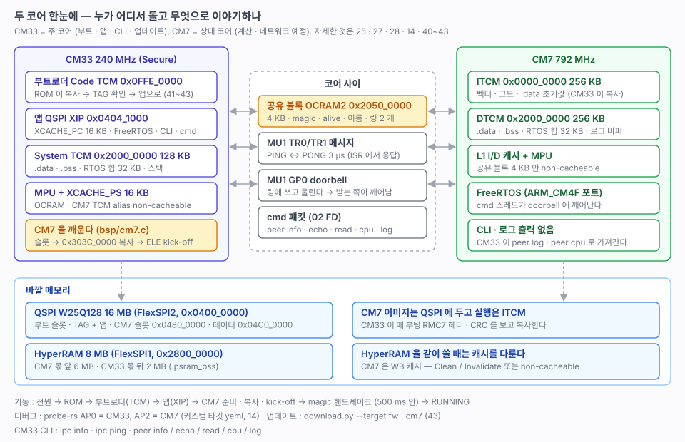

# 04. 두 코어 — 역할, 실행 위치, 캐시, 코어 간 통신

> CM33 과 CM7 이 각각 무엇을 하고, 어디서 돌고, 무엇으로 이야기하는지 한 곳에 모았다. 이 문서는 **정리**다. 구현과 측정은 각 문서에 있다.
> 관련: [25-cm7-boot.md](25-cm7-boot.md) (기동 · MU · 패킷 통신) · [14-cm7-debug.md](14-cm7-debug.md) · [27-hyperram.md](27-hyperram.md) (캐시 규칙) · [28-freertos.md](28-freertos.md) (두 코어 RTOS) · [40-boot-architecture.md](40-boot-architecture.md) ~ [43-uart-download.md](43-uart-download.md) (부트로더 · 업데이트) · [02-memory-map.md](02-memory-map.md)



---

## 1. 역할

| | CM33 (주 코어) | CM7 (상대 코어) |
|---|---|---|
| 클럭 | 240 MHz (SYS_PLL3 ÷ 2) | 792 MHz (ARM PLL, 오버드라이브 1.125 V) |
| 보안 상태 | Secure (`-mcmse`) | — |
| 하는 일 | 부팅 · 부트로더 · 업데이트, CLI · 로그, 주변장치, CM7 기동과 감시 | 지금은 cmd 응답(`peer`)만. 네트워크(50번대) · 계산을 맡길 자리 |
| RTOS | FreeRTOS `ARM_CM33_NTZ` (Secure only) | FreeRTOS `ARM_CM4F` (CM7 r1p2) |
| 입출력 | UART(MCU-Link VCOM) · CLI · 로그 | **없다.** 로그는 DTCM 버퍼에 쌓고 CM33 이 `peer log` 로 가져간다 |
| 프로젝트 | `rt1180-boot` (부트로더), `rt1180-fw/src/cpu/cm33` (앱) | `rt1180-fw/src/cpu/cm7` (`-DBUILD_CM7=ON`) |

CM33 이 주인이다. CM7 은 CM33 이 깨워야 돌고, 죽어도 CM33 이 안다(alive).

## 2. 실행 위치와 캐시

| | 코드 | 데이터 | 캐시 |
|---|---|---|---|
| CM33 부트로더 | **Code TCM** `0x0FFE_0000` (ROM 이 QSPI 에서 복사, [41](41-bootloader.md)) | System TCM | 켜지 않는다 (TCM 만 쓴다) |
| CM33 앱 | **QSPI XIP** `0x0404_1000` | System TCM `0x2000_0000` 128 KB | `XCACHE_PC` 16 KB (코드 버스, `SystemInit`) · `XCACHE_PS` 16 KB (시스템 버스, MPU 로 영역마다, [27](27-hyperram.md) 6절) |
| CM7 | **ITCM** `0x0000_0000` 256 KB (CM33 이 QSPI CM7 슬롯에서 복사) | DTCM `0x2000_0000` 256 KB | L1 I/D (MPU 로 영역마다, [25](25-cm7-boot.md) 9절) |

- **같은 주소, 다른 메모리.** `0x0000_0000` 과 `0x2000_0000` 은 두 코어에서 서로 다른 TCM 이다. 상대 코어의 TCM 은 alias 로 본다 — CM33 에서 CM7 ITCM 은 `0x303C_0000`(Secure). 두 코어가 같은 주소로 보는 것은 OCRAM 과 HyperRAM 이다([02](02-memory-map.md) 1절, [25](25-cm7-boot.md) 2절 그림).
- **CM7 을 ITCM 에서 돌리는 이유.** 792 MHz 에서 대기 없이 돌고, CM33 이 QSPI 를 지우고 쓰는 동안에도 멈추지 않는다(XIP 였다면 같이 멈춘다). SDK 도 CM7 은 RAM 타깃만 켜 두었다. 256 KB 를 넘을 때의 순서는 [25](25-cm7-boot.md) 12절.

### 캐시 영역

| 메모리 | CM33 (`XCACHE_PS`, cm33/bsp/mpu.c) | CM7 (L1, cm7/bsp/mpu.c) |
|---|---|---|
| OCRAM1 · OCRAM2 | non-cacheable | write-back |
| 공유 블록 OCRAM2 앞 4 KB | non-cacheable | **non-cacheable** (MPU 7 번) |
| 상대 코어 TCM alias | non-cacheable · XN | — |
| HyperRAM | CM7 몫 non-cacheable, **CM33 몫 2 MB write-back** | 8 MB write-back |
| QSPI | `XCACHE_PC` (XIP 코드) | 열지 않는다 (Device) |

**두 코어가 같은 메모리를 볼 때의 규칙** ([27](27-hyperram.md) 4절):

- 작은 신호 · 상태는 **공유 블록**(양쪽 다 non-cacheable)에 둔다. 캐시를 신경 쓸 일이 없다.
- 큰 데이터는 HyperRAM 에 두고 위치와 길이만 cmd 패킷으로 넘긴다. 쓴 쪽은 Clean, 읽는 쪽은 Invalidate(32 B 줄 단위). 아니면 그 구간만 non-cacheable 로 잡는다.
- 실제로 CM7 이 캐시에 남은 옛 값을 읽는 것을 확인했다(`peer read`, [27](27-hyperram.md) 4절).

### 측정한 속도

| 코어 · 메모리 | 값 | 출처 |
|---|---|---|
| CM33 QSPI 읽기 (메모리 맵) | 28.5 MB/s (앱 XIP) · 31.7 MB/s (부트로더 TCM) | [26](26-qspi-nor.md) 1절 · [41](41-bootloader.md) 5절 |
| CM33 HyperRAM 32 bit 쓰기 / 읽기 | 캐시 끔 24.0 / 38.8 MB/s → **WB 51.0 / 62.6 MB/s** | [27](27-hyperram.md) 6절 |
| CM7 OCRAM1 16 KB 읽기 | 캐시 끔 170.7 µs → 캐시 히트 **15.5 µs** (DTCM 과 같다) | [25](25-cm7-boot.md) 9절 |

아직 재지 않은 것: CM33 코드를 XIP 와 TCM 에서 돌렸을 때의 차이, CM7 의 HyperRAM 속도.

## 3. 코어 간 통신 — 세 층

| 층 | 무엇 | 쓰는 곳 | 속도 |
|---|---|---|---|
| **상태** | 공유 블록 `shared_t` (OCRAM2 `0x2050_0000`, 4 KB) — magic · version · alive · 이름 · 버전 · 클럭 | 핸드셰이크, 살아 있는지 | 언제 읽어도 된다 |
| **알림** | MU1 메시지 — `id` + `data` (TR0/TR1) | `ipc ping` (PING → CM7 ISR 에서 PONG) | 왕복 3~5 µs |
| **데이터** | 공유 블록의 링 2 개(방향마다 1 KB, 단일 생산자/소비자) + MU GP0 doorbell, 그 위에 cmd 패킷(`02 FD`) | `peer info · echo · read · cpu · log` | `peer echo 512` 왕복 537~593 µs (한 방향 약 0.9 MB/s) |

- 규약은 한 파일, `cpu/shared/shared.h` 에 있다(이미지 헤더, 공유 블록, 메시지 id, 링, cmd 번호). 구조를 바꾸면 `SHARED_VERSION`(지금 2)을 올리고 두 코어를 같이 빌드한다. 한쪽만 빌드하면 `BAD_VERSION`.
- cmd 패킷은 PC ↔ 보드 UART 와 **같은 형식 · 같은 코드**(`common/hw/src/cmd.c`)다. 코어 간 채널(`drv_ipc`)과 UART 채널(`drv_uart`, [43](43-uart-download.md))이 한 `cmd` 모듈 안에 나란히 있다.
- 받는 쪽은 바쁘게 돌지 않는다. CM7 cmd 스레드는 doorbell 세마포어에서 자고, 오면 깨어 다 처리한다(CM7 idle 99.9 %, [28](28-freertos.md) 5절).
- 큰 데이터를 패킷에 싣지 않는다. 남은 시간 대부분이 파서의 바이트 단위 처리라, 영상 · 네트워크 프레임은 공유 버퍼를 직접 넘기고 위치만 보낸다.

## 4. 기동 순서

```
전원 / 리셋
  └ BootROM (CM33) ─ FCB · XMCD(HyperRAM) · 컨테이너 → 부트로더를 Code TCM 으로 복사 ...... 01 · 41
      └ 부트로더 ─ TAG · CRC 확인 → 앱으로 점프 (머물 조건이면 CLI · 다운로드) .............. 42 · 43
          └ 앱 bspInit ─ 클럭 · MPU · XCACHE_PS
              └ hwInit ─ ... → ipcInit ................................................................ 25
                  1 공유 블록 magic 지우기, 링 비우기, MU 열기
                  2 CM7 슬롯 RMC7 헤더 · CRC 확인
                  3 cm7Prepare : DCDC 1.125 V · ARM PLL 792 MHz · TCM ECC 초기화(DMA 64 bit)
                  4 cm7Load    : 슬롯 → 0x303C_0000
                  5 cm7Start   : ELE kick-off (S3MU) → M7_CFG.WAIT = 0
                  6 CM7 ipcInit 가 자기소개를 채우고 magic 을 마지막에 → 500 ms 안이면 RUNNING
```

| `ipc info` 상태 | 뜻 |
|---|---|
| `DISABLED` | `BUILD_CM7=OFF` 로 빌드했다 |
| `NO_IMAGE` | CM7 슬롯에 맞는 이미지가 없다 |
| `START_FAIL` | ELE 가 kick-off 를 거절했다 |
| `TIMEOUT` | 깨웠는데 500 ms 안에 magic 이 안 섰다 |
| `BAD_VERSION` | `SHARED_VERSION` 이 다르다 (한쪽만 빌드) |
| `RUNNING` | 정상. 이후 alive 가 100 ms 동안 안 오르면 죽은 것으로 본다 |

## 5. 기록 · 업데이트 · 디버그

| 할 일 | CM33 | CM7 |
|---|---|---|
| 이미지 | `rt1180-fw-cm33-tag.bin` (TAG + 앱) → `0x0404_0000` | `rt1180-fw-cm7.img` (RMC7 16 B + ITCM bin) → `0x0480_0000` |
| probe-rs | 태스크 `flash-cm33` (둘 다는 `flash-all`) | `flash-cm7` |
| UART | `download.py --target fw` (태스크 `download-cm33`) | `download.py --target cm7` (`download-cm7`) — 점프한 뒤 앱이 새 이미지로 CM7 을 깨운다 |
| 둘 다 | `download.py --target all` (`download-all`) — CM7 → 앱 → TAG | 앱이 부팅 때 짝 확인, 다르면 경고만 ([44](44-cm7-pair.md)) |
| 디버그 | AP 0. `Flash + Debug CM33 (Cortex-Debug)` 또는 probe-rs `Attach CM33` | AP 2. 커스텀 타깃 `tools/probe-rs/MIMXRT1186.yaml` 로 **attach 만** ([14](14-cm7-debug.md)) |

CM7 elf 는 ITCM 주소(`0x0`)라 플래시에 그대로 쓸 수 없다. 그래서 헤더를 붙인 bin 을 슬롯에 쓰고, 실행 위치로는 CM33 이 매 부팅 복사한다([25](25-cm7-boot.md) 3절).

## 6. CLI 로 보기 (CM33)

| 명령 | 보는 것 |
|---|---|
| `ipc info` | 상태 · 이미지 헤더 · ELE 응답 · alive · 메시지 수 |
| `ipc ping [n]` | MU 메시지 왕복 |
| `peer info` | CM7 이름 · 버전 (cmd 패킷) |
| `peer echo size n` | 패킷 왕복 · 데이터 일치 |
| `peer read addr` | CM7 이 직접 읽은 메모리 값 (캐시 확인) |
| `peer cpu` | CM7 idle 비율 |
| `peer log` | CM7 부팅 로그 |

## 7. 다음

- [ ] CM7 에 일 맡기기 — 50번대 네트워크(ENETC · lwIP)
- [ ] `cli cm7` 원격 CLI ([90](90-todo-cm7-remote-cli.md))
- [ ] CM7 → CM33 이벤트 (예: 링크 상태 → LED) — cmd 패킷으로 ([29](29-event.md) 5절)
- [ ] CM7 HyperRAM 속도, CM33 XIP vs TCM 코드 속도 측정
