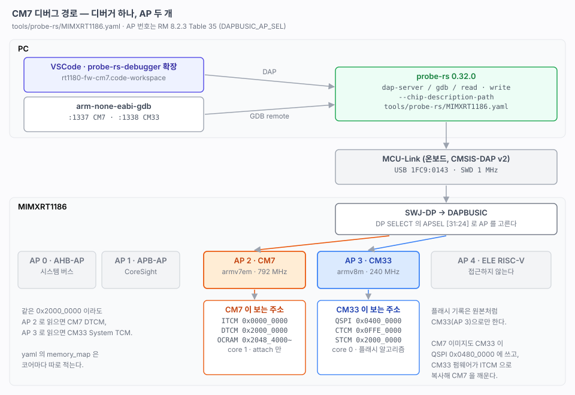

# 14. CM7 디버그

> probe-rs 에 없는 CM7 코어를 타깃 파일로 더해서, 같은 MCU-Link 로 CM7 을 멈추고 스텝하기까지의 기록. 무엇을 만들었는지, 디버거가 CM7 에 어떤 경로로 닿는지, 쓸 때 알아야 할 한계를 적는다.
> 관련: [10-dev-environment.md](10-dev-environment.md) · [25-cm7-boot.md](25-cm7-boot.md) · [02-memory-map.md](02-memory-map.md)
>
> 출처: RM 8.2 System Debug (8.2.3 Table 35 Address Decoding for DAPBUSIC), probe-rs 0.32.0 `probe-rs/targets/MIMXRT1180.yaml`.



---

## 1. 왜 따로 만들어야 했나

probe-rs 0.32.0 에 들어 있는 `MIMXRT1180.yaml` 은 **CM33 코어 하나만** 정의한다.

```bash
$ probe-rs chip info MIMXRT1180
Cores (1):
    - cm33 (Armv8m)
```

그래서 기본 정의로는 CM33 만 멈추고 읽을 수 있다. CM7 은 칩 안에 따로 디버그 포트(AP)가 있는데, probe-rs 가 그 존재를 모른다. probe-rs 는 칩 정의를 yaml 로 받으므로 **CM7 코어를 더한 yaml 을 저장소에 두고 그것을 쓰게** 했다. probe-rs 를 고치거나 다시 빌드하지 않는다.

## 2. 동작 방식

### 2-1. 디버거 하나, AP 여러 개

칩 바깥에서 보이는 디버그 포트는 SWD 하나다(SWJ-DP). 그 안에서 **DAPBUSIC** 이 여러 AP(Access Port) 로 갈라진다. 디버거는 DP 의 `SELECT` 레지스터 `APSEL[31:24]` 에 번호를 써서 어느 AP 와 이야기할지 고른다.

| APSEL | 목적지 (RM Table 35) | 이 프로젝트 |
|---|---|---|
| 0 | AHB-AP → 시스템 버스 | 쓰지 않는다 |
| 1 | APB-AP → CoreSight | 쓰지 않는다 |
| **2** | **DAP-AP → M7** | **CM7 (core 1)** |
| **3** | **DAP-AP → M33** | **CM33 (core 0)** — probe-rs 원본 정의 |
| 4 | DAP-AP → EdgeLock RISC-V | 접근하지 않는다 |
| 6 | MDM-AP | 쓰지 않는다 |

AP 하나는 그 코어의 버스 마스터처럼 동작한다. AP 2 로 메모리를 읽으면 **CM7 이 보는 주소**로, AP 3 로 읽으면 **CM33 이 보는 주소**로 읽힌다. 그래서 같은 `0x2000_0000` 이 AP 2 에서는 CM7 DTCM, AP 3 에서는 CM33 System TCM 이다([25-cm7-boot.md](25-cm7-boot.md) 2절 그림).

probe-rs 로그에서 실제로 이렇게 고른다.

```
Changing SELECT to DPv1(SelectV1 { ap_sel: 2, ... })     # CM7 쪽으로
Write(port=ApRegister(4), data=0xe000edf0)                # TAR = DHCSR
Write(port=ApRegister(12), data=0xa05f0001)               # DRW : C_DEBUGEN
```

### 2-2. 타깃 파일이 하는 일

`tools/probe-rs/MIMXRT1186.yaml` 은 원본 yaml 에 세 가지를 더하거나 바꿨다.

| 바꾼 것 | 내용 |
|---|---|
| 이름 | `MIMXRT1180` → `MIMXRT1186`. 원본 내장 정의와 이름이 겹치지 않게 한다 |
| 코어 | `cm7`, `armv7em`, `ap: !v1 2` 를 추가. 순서상 **core 1** 이다 (cm33 = core 0) |
| 메모리 맵 | CM7 이 보는 영역(ITCM `0x0`, DTCM `0x2000_0000`, OCRAM `0x2048_4000~`)을 `cores: [cm7]` 로 추가 |

```yaml
  cores:
  - name: cm33
    type: armv8m
    core_access_options: !Arm
      ap: !v1 3
  - name: cm7
    type: armv7em
    core_access_options: !Arm
      ap: !v1 2
```

원본의 CM33 메모리 맵과 플래시 알고리즘(`flexspi1/2_qspi_cm33`)은 그대로 두었다. **플래시 기록은 CM33(AP 3)으로만 한다.** CM7 은 플래시를 직접 다루지 않는다.

### 2-3. CM7 은 launch 가 아니라 attach

CM33 은 리셋하면 ROM 이 QSPI 에서 바로 실행한다. 그래서 디버거가 "기록 → 리셋 → 엔트리에서 정지"(launch)를 할 수 있다.

CM7 은 다르다. CM7 이미지는 QSPI `0x0480_0000` 에 보관만 되어 있고, **CM33 펌웨어가 ITCM 으로 복사한 뒤 깨운다**([25-cm7-boot.md](25-cm7-boot.md) 4절). 디버거가 CM7 을 리셋해서 처음부터 돌릴 방법이 없다. 그래서 CM7 은 언제나 이 순서다.

1. `flash` 태스크로 CM7 이미지(`.img` → `0x0480_0000`)와 CM33 elf 를 쓰고 리셋한다.
2. CM33 이 부팅하면서 CM7 을 깨운다(약 10 ms).
3. 디버거가 AP 2 로 **돌고 있는 CM7 에 붙는다(attach).**

그래서 CM7 의 `Reset_Handler` 나 `main()` 첫 줄에서는 멈출 수 없다. 거기를 봐야 하면 CM7 쪽에 "디버거가 붙을 때까지 기다리는" 루프를 넣는 방법이 있다. 아직 필요하지 않아 넣지 않았다.

## 3. 쓰는 법

### 3-1. 명령줄

```bash
Y=tools/probe-rs/MIMXRT1186.yaml

# CM7 메모리 읽기 (코어를 멈추지 않는다)
probe-rs read  --chip-description-path $Y --chip MIMXRT1186 --core 1 b32 0x0 2

# CM33 은 core 0. 원본 정의(--chip MIMXRT1180)도 그대로 쓸 수 있다
probe-rs read  --chip-description-path $Y --chip MIMXRT1186 --core 0 b32 0x20000404 1

# GDB 서버: 코어마다 포트가 하나씩 열린다
probe-rs gdb   --chip-description-path $Y --chip MIMXRT1186
#   Firing up GDB stub for Armv7em cores at 127.0.0.1:1337    ← CM7
#   Firing up GDB stub for Armv8m cores at 127.0.0.1:1338     ← CM33

arm-none-eabi-gdb build/cm7/rt1180-fw-cm7.elf -ex "target extended-remote :1337"
```

### 3-2. VSCode

`prj/rt1180-fw-cm7.code-workspace` 에 두 구성이 있다. 둘 다 `chipDescriptionPath` 로 위 yaml 을 쓰고 `coreIndex: 1` 로 CM7 을 고른다.

| 구성 | 하는 일 |
|---|---|
| **Flash + Attach CM7** | `flash` 태스크(빌드 → CM7 이미지 · CM33 elf 기록 → 리셋) 후 CM7 에 붙는다 |
| **Attach CM7** | 돌고 있는 CM7 에 그대로 붙는다 |

```json
{
  "name": "Attach CM7",
  "type": "probe-rs-debug",
  "request": "attach",
  "chip": "MIMXRT1186",
  "chipDescriptionPath": "${workspaceFolder}/tools/probe-rs/MIMXRT1186.yaml",
  "coreConfigs": [{
    "coreIndex": 1,
    "programBinary": "${workspaceFolder}/build/cm7/rt1180-fw-cm7.elf",
    "svdFile": "${workspaceFolder}/tools/svd/MIMXRT1186_cm7.xml"
  }]
}
```

이 워크스페이스의 configure 태스크는 `-DBUILD_CM7=ON` 으로 돈다. CM7 이미지가 빌드되어야 `flash` 가 CM7 슬롯까지 쓴다.

**전체 워크스페이스.** `prj/rt1180-fw.code-workspace` 에는 두 코어를 **한 디버그 세션**으로 붙는 구성도 있다. `coreConfigs` 에 core 0(CM33)과 core 1(CM7)을 같이 넣는다. 두 코어 모두 attach 라 어느 쪽도 리셋하지 않는다.

| 구성 | 하는 일 |
|---|---|
| **Flash + Attach CM33 + CM7** | `flash` 후 두 코어에 같이 붙는다 |
| **Attach CM33 + CM7** | 돌고 있는 두 코어에 같이 붙는다 |
| **Attach CM33** · **Attach CM7** | 한 코어만 |

## 4. 확인한 것

| 확인 | 결과 |
|---|---|
| CM7 ITCM 벡터 | `0x0` = `0x2004_0000 0x0000_047D` 를 5 번 읽어 모두 같다. elf 의 `__StackTop`, `Reset_Handler`(`0x47C` + Thumb 비트)와 같다 |
| CM7 이 도는지 | CM7 DTCM 의 `systick_ms`(`0x2000_01C8`)가 1 초 간격으로 약 1000 늘어난다 |
| 읽기가 CM7 을 방해하는지 | 읽는 동안에도 CM33 `ipc info` 의 alive 가 `+51 / 500ms` 그대로 는다 |
| GDB 로 멈추기 | 소스 줄과 호출 스택이 나온다. 공유 블록도 CM7 심볼로 읽힌다 |
| VSCode | Attach CM7 로 붙어 `ap.c` 브레이크포인트에서 멈추고 스텝이 된다 |

```
#0  delay (ms=10) at src/cpu/cm7/bsp/bsp.c:32
#1  apMain () at src/cpu/cm7/ap/ap.c:15
#2  main () at src/cpu/cm7/main.c:10
(gdb) print/x shared
$1 = {magic = 0x48535452, version = 0x1, peer_alive = 0x2a7d, ...}
```

## 5. 한계와 주의

### `delay()` 안에서는 스텝이 안 된다

CM7 은 대부분의 시간을 `delay(10)` 의 한 줄 루프에서 보낸다. 그래서 그냥 멈추면 거의 항상 여기 걸린다.

```c
while (systick_ms - pre_time < ms);      // bsp.c:32
```

이 자리에서 VSCode 의 Step Over 는 `Step error @0x000010B6: Unable to determine target address` 로 실패하고, Step Out 도 되지 않는다.

`-Og` 로 빌드하면 이 줄 뒤의 비교·분기(`0x10BA`)와 `}`(`0x10BE`)에 줄 정보의 `is_stmt`(문장 시작) 표시가 붙지 않는다. probe-rs 의 Step Over 는 "같은 함수 안에서 다음 문장이 시작하는 주소"에 정지점을 거는데, 그런 주소가 없어서 실패한다. GDB 는 명령어 단위로 걸어 나가므로 같은 자리에서도 넘어간다.

```
bsp.c   32   0x10b4   x      ← 문장 시작
bsp.c   32   0x10ba          ← is_stmt 없음
bsp.c   33   0x10be          ← is_stmt 없음 (})
```

**대처: `ap.c` 처럼 줄 정보가 온전한 곳에 브레이크포인트를 걸고 거기서 스텝한다.** `apMain()` 의 줄은 모두 `is_stmt` 가 있다.

### `probe-rs gdb` 에서 detach 하면 CM7 이 멈춘 채 남는다

GDB 를 `detach` 해도 probe-rs GDB 서버는 코어를 다시 돌리지 않았다. CM7 의 `DHCSR` 에 직접 써서 풀었다.

```bash
probe-rs write --chip-description-path $Y --chip MIMXRT1186 --core 1 b32 0xE000EDF0 0xA05F0000
```

VSCode 확장은 연결을 끊을 때 코어를 다시 돌린다.

### CM7 이 멈춰도 CM33 의 상태는 RUNNING 이다

`ipc info` 의 `state` 는 기동할 때 한 번 정한다. 디버거로 CM7 을 멈추면 alive 가 늘지 않지만 `state` 는 그대로 `RUNNING` 이다. 살아 있는지는 `running` 줄(alive 가 `HW_IPC_ALIVE_TIMEOUT_MS` 안에 늘었는지)로 본다.

### 디버그 포트가 WAIT 로 막힌 적이 한 번 있다

처음 AP 2 에 붙을 때 `Target device responded with a WAIT response` 가 났고, 그 뒤 CM33(AP 3) 접근까지 막혔다. `probe-rs reset`(SYSRESETREQ)으로는 풀리지 않았고 **SW3(POR_B)** 으로 풀렸다. 그 뒤 같은 명령을 여러 번 돌렸지만 다시 나지 않았다.

직전에 CM33 의 `DHCSR` 를 직접 써서 멈췄다 풀었던 것과 관련이 있는지는 아직 모른다. 다시 나면 `RUST_LOG=probe_rs=debug` 로그를 남겨 어느 접근에서 막히는지 본다.

### 디버거와 baram-term 은 서로 다르다

디버그(SWD)와 콘솔(VCOM)은 같은 MCU-Link 의 다른 인터페이스다. 디버깅 중에도 baram-term 으로 콘솔을 볼 수 있다. 반대로 콘솔 포트를 다른 프로그램이 잡고 있으면 그 프로그램이 출력을 가져가므로, 직접 포트를 열기 전에 `lsof` 로 확인한다.

## 6. 다음

- [ ] CM7 캐시를 켰다([25](25-cm7-boot.md) 9절). 디버거로 읽은 OCRAM 값과 CM7 D-cache 에 있는 값이 다를 수 있다. 공유 블록은 non-cacheable 이라 상관없다. cacheable 구간을 디버거로 볼 때 어떻게 보이는지는 아직 확인하지 않았다.
- [ ] CM7 을 처음부터 디버그해야 할 때 — CM7 startup 에 "디버거 대기" 플래그를 두는 방법 검토.
- [ ] CM33 워크스페이스도 같은 yaml 을 쓰게 맞출지 검토. 지금은 원본 `MIMXRT1180` 정의로 충분하다.
