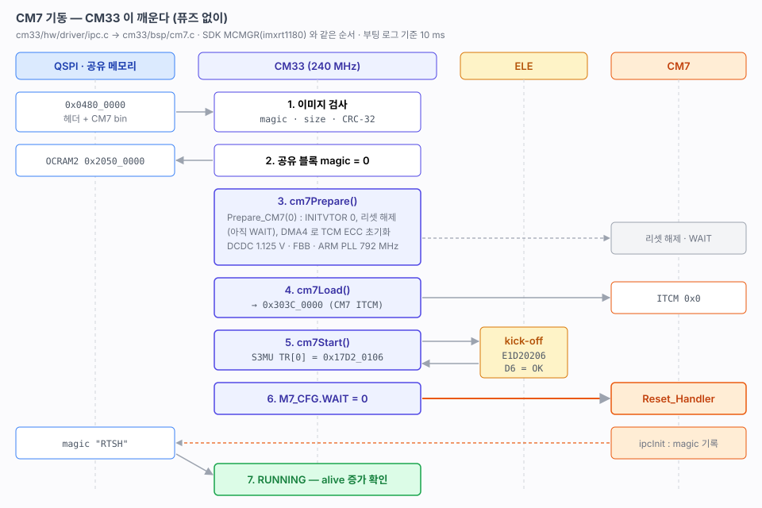
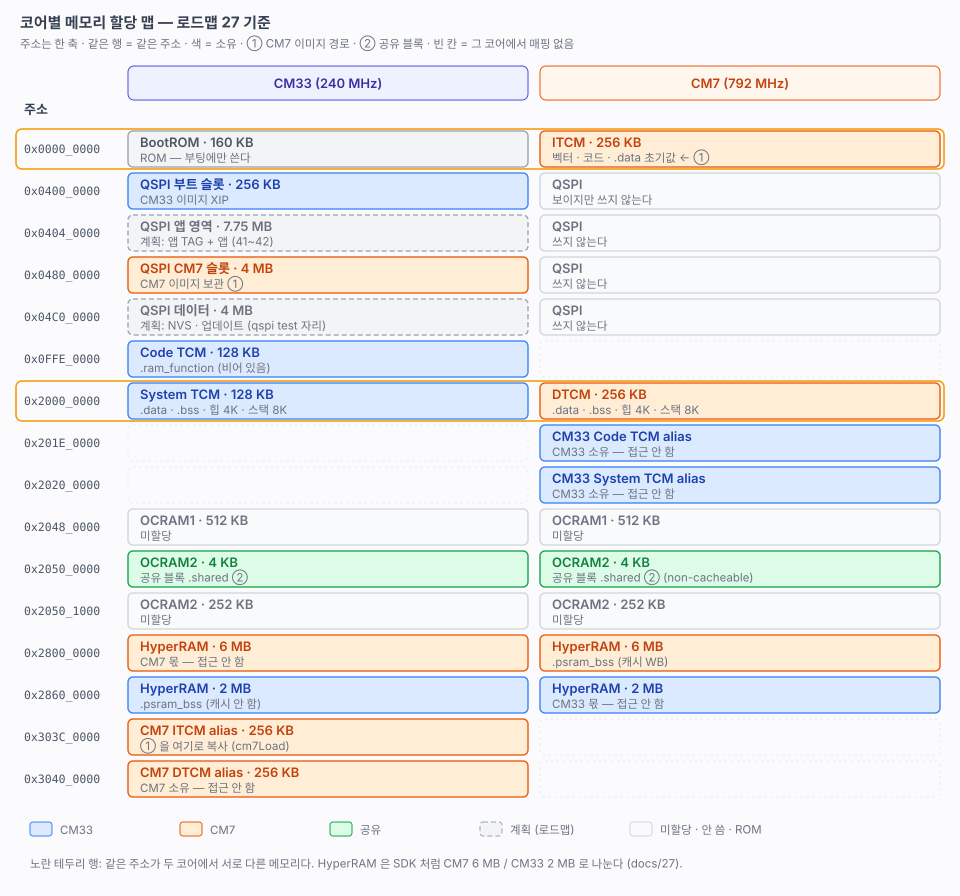
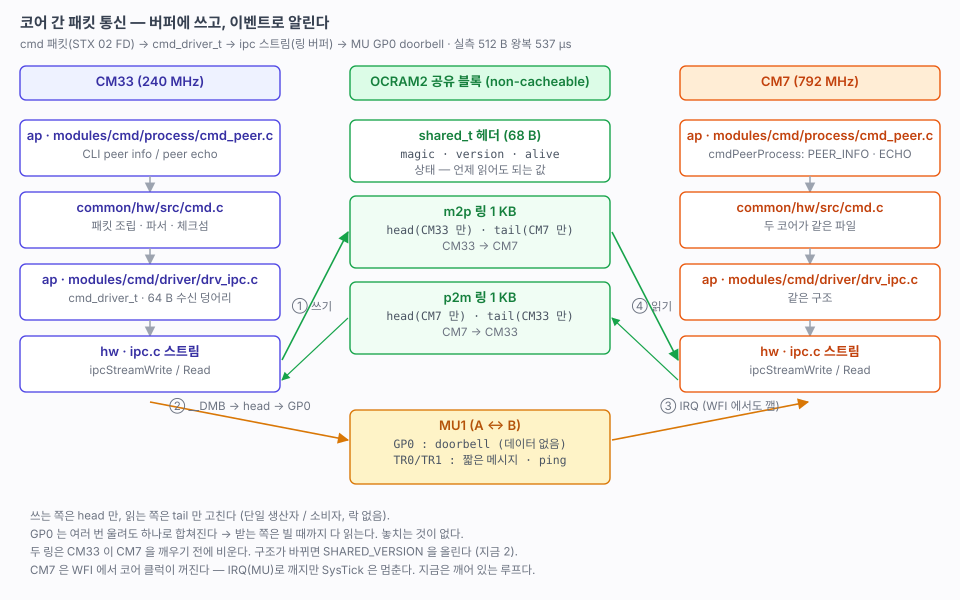

# 25. CM7 기동

> 퓨즈를 굽지 않고 CM33 이 CM7 을 깨운 기록. CM7 이미지 형식, 오버드라이브 전압과 ARM PLL, EdgeLock(ELE) kick-off 명령, 공유 블록 핸드셰이크를 다룬다.
> 관련: [14-cm7-debug.md](14-cm7-debug.md) · [01-boot-sequence.md](01-boot-sequence.md) 6절 · [02-memory-map.md](02-memory-map.md) 1절, 5절 · [22-clock.md](22-clock.md)
>
> 출처: SDK `system_MIMXRT1186_cm33.c` (`Prepare_CM7`), `mcux-mcmgr` `src/mcmgr_internal_core_api_imxrt1180.c` (`mcmgr_start_core_internal`), `frdmimxrt1186/multicore_examples` (`hello_world`, `clock_config.c`), `board.c` (`DCDC_SetVoltage`), IMXRT1180EC 데이터시트 (Over Drive Run).



---

## 1. 결과

```
[OK] CM7 RUNNING (10 ms)
     name  : FRDM-IMXRT1186-CM7
     ver   : V261010R1
     clock : 792 MHz

cli# ipc info
state      : RUNNING
image      : 0x04800000 magic 0x37434D52 size 9940 crc 0x6F1733DA (calc 0x6F1733DA)
ele resp   : 0xE1D20206 0x000000D6 (err 0)
alive      : 249  (+52 / 500ms)
```

`hwinfo clock` 의 M7 루트 실측은 **792.05 MHz** 다. CM33 은 그대로 240 MHz 다.

## 2. 구조

titan-mini 의 CPU1 기동과 같은 틀이다. 공유 블록 핸드셰이크, `ipc` 공개 API, `BUILD_*` 옵션을 그대로 따른다. 다른 점은 이미지 위치와 깨우는 방법이다.

| | titan-mini (RA8P1) | 여기 (RT1186) |
|---|---|---|
| 상대 코어 이미지 | MRAM 의 자기 파티션에서 실행 | **QSPI CM7 슬롯 → CM7 ITCM 으로 복사해서 실행** |
| 깨우기 | FSP `R_BSP_SecondaryCoreStart()` | **ELE 에 kick-off 명령 + M7_CFG.WAIT 해제** |
| 공유 블록 | SRAM 끝 non-cacheable | OCRAM2 `0x2050_0000` (두 코어가 같은 주소로 본다) |

| 파일 | 역할 |
|---|---|
| `cpu/shared/shared.h` | 두 코어의 규약 — CM7 이미지 헤더 `cm7_image_t`, 공유 블록 `shared_t` |
| `cpu/cm33/bsp/cm7.c` | 레지스터 수준 기동 — `cm7Prepare`, `cm7Load`, `cm7Start` |
| `cpu/cm33/hw/driver/ipc.c` | 주 코어 — 이미지 검사, 기동, 핸드셰이크, `ipc info` |
| `cpu/cm7/hw/driver/ipc.c` | 상대 코어 — 자기소개 후 magic, `ipcUpdate()` 로 alive 증가 |
| `cpu/cm7/` | CM7 프로젝트 — main → bsp → hw → ap (titan-mini cm33 과 같은 최소 구성) |
| `tools/mkcm7img.py` | CM7 bin 앞에 헤더를 붙여 `.img` 를 만든다 |

### 메모리 할당



두 링커 스크립트가 잡은 영역이다. 사용량이 아니라 **어느 코어가 어느 영역을 무엇으로 쓰는지**다. 그림은 주소를 한 축으로 두고 같은 행에 두 코어가 그 주소에서 보는 것을 나란히 그렸다. 노란 테두리 행(`0x0000_0000`, `0x2000_0000`)은 같은 주소가 두 코어에서 서로 다른 메모리다. 빈 칸은 그 코어에서 매핑이 없는 주소다.

| 물리 메모리 | CM33 주소 | CM7 주소 | 링커 영역 | 할당 |
|---|---|---|---|---|
| QSPI 부트 슬롯 256 KB | `0x0400_0000` | — | cm33 `FCB` `CONTAINER` `VECTORS` `FLASH` | CM33 이미지 (XIP) |
| QSPI CM7 슬롯 4 MB | `0x0480_0000` | — | (링커 밖, `flash` 타깃이 `.img` 를 씀) | CM7 이미지 보관 |
| CM33 Code TCM 128 KB | `0x0FFE_0000` | `0x201E_0000` | cm33 `ITCM` | `.ram_function` |
| CM33 System TCM 128 KB | `0x2000_0000` | `0x2020_0000` | cm33 `DTCM` | `.data` `.bss` 힙 4K 스택 8K |
| CM7 ITCM 256 KB | `0x303C_0000` | `0x0000_0000` | cm7 `ITCM` | 벡터 · 코드 · `.data` 초기값 |
| CM7 DTCM 256 KB | `0x3040_0000` | `0x2000_0000` | cm7 `DTCM` | `.data` `.bss` 힙 4K 스택 8K |
| OCRAM2 앞 4 KB | `0x2050_0000` | `0x2050_0000` | cm33 · cm7 `SHARED` | `.shared` (`shared_t`) |
| HyperRAM 앞 6 MB | `0x2800_0000` | `0x2800_0000` | cm7 `PSRAM` | `.psram_bss` (CM7 이 캐시, [27](27-hyperram.md)) |
| HyperRAM 뒤 2 MB | `0x2860_0000` | `0x2860_0000` | cm33 `PSRAM` | `.psram_bss` (CM33 도 캐시, [27](27-hyperram.md) 6절) |
| OCRAM1, OCRAM2 나머지 | | | — | 미할당 |

QSPI 의 앱 영역(`0x0404_0000`)과 데이터 영역(`0x04C0_0000`)은 파티션 계획만 있다([02](02-memory-map.md) 5절).

## 3. CM7 이미지

| 단계 | 결과물 |
|---|---|
| 링크 | `rt1180-fw-cm7.elf` — **CM7 ITCM `0x0`** 에 링크. 벡터 · 코드 · `.data` 초기값이 ITCM 한 덩어리 |
| objcopy | `rt1180-fw-cm7.bin` — ITCM 덩어리 (NOLOAD 인 `.bss`, `.shared` 는 빠진다) |
| `mkcm7img.py` | `rt1180-fw-cm7.img` — 16 B 헤더 + bin |
| `flash` 타깃 | `.img` 를 QSPI **`0x0480_0000`** (CM7 슬롯, [02](02-memory-map.md) 5절)에 bin 으로 쓴다 |

헤더(`cm7_image_t`)는 다음과 같다.

| 오프셋 | 필드 | 값 |
|---|---|---|
| 0 | magic | `0x37434D52` ("RMC7") |
| 4 | size | 헤더 뒤 바이트 수 (≤ 256 KB) |
| 8 | crc32 | IEEE 802.3 반사형 (`zlib.crc32` 와 같다) |
| 12 | reserved | 0 |

CM33 은 기동 전에 셋을 다 확인한다. 하나라도 틀리면 `NO_IMAGE` 로 남고 CM7 을 깨우지 않는다. 빈 플래시나 낡은 이미지로 뛰지 않기 위해서다.

### SDK 와 다른 점

SDK 멀티코어 예제(`multicore_examples/hello_world`)도 CM7 을 **ITCM 에서 돌린다.** 이 보드의 `frdmimxrt1186@cm7` 빌드 목록은 RAM 타깃(`cm7_ram.ld`)만 켜져 있다. `flexspi_nor`(XIP)와 `hyperram` 타깃은 꺼져 있다. CM33 이 `0x303C_0000` 에 복사하고 `MCMGR_StartCore()` 로 깨우는 것도 같다.

다른 것은 CM7 이미지를 어디에 담느냐다.

| | SDK | 여기 |
|---|---|---|
| CM7 이미지 위치 | **CM33 이미지 안.** CM7 bin 을 CM33 링크 때 `.core1_code` 섹션으로 넣는다 (`core1_image_start`, 최대 256 KB) | **별도 QSPI 슬롯** `0x0480_0000` + 헤더 |
| 검증 | 없음. 같은 이미지라 짝이 항상 맞는다 | magic · 크기 · CRC, 공유 블록 version |
| 기록 | CM33 하나 | `.img` 와 CM33 elf 둘 |
| 장점 | 한쪽만 기록해 짝이 어긋날 일이 없다 | 코어별 ELF (titan-mini 와 같다), 파티션 계획과 맞는다, 부트로더가 CM7 만 따로 갱신할 수 있다 |

어느 쪽으로 갈지는 부트로더 설계(로드맵 40)에서 다시 정한다.

### 왜 elf 를 바로 쓰지 않나

CM7 elf 의 주소는 CM7 ITCM(`0x0`)이다. probe-rs 에 그대로 넘기면 ITCM 에 쓰려고 하고, 리셋하면 사라진다. 그래서 bin 으로 떠서 플래시 슬롯에 쓰고, 실행 위치로는 CM33 이 매 부팅 복사한다. 부트로더가 생기면(로드맵 44) 같은 형식을 그대로 쓴다.

## 4. 깨우는 순서 — `bsp/cm7.c`

### 4-1. `cm7Prepare()`

| 순서 | 내용 | 출처 |
|---|---|---|
| 1 | `Prepare_CM7(0)` | SDK `system_MIMXRT1186_cm33.c`. PHY_LDO, ARM PLL 전원, DCDC REG3 을 설정하고 `M7_CFG.INITVTOR = 0` 과 `SRC SCR.BT_RELEASE_M7` 을 쓴다. 그리고 **DMA4 로 CM7 ITCM/DTCM 512 KB 를 64 bit 쓰기로 채운다** |
| 2 | DCDC CORE0/1 → **1.125 V**, `PMU_EnableFBB(true)` | 오버드라이브. CM7 792 MHz 에 필요하다 (SDK 멀티코어 `clock_config.c`) |
| 3 | `CLOCK_InitArmPll` 24 MHz × 132 / 4 = **792 MHz** (락 대기) | 〃 |
| 4 | M7 루트 = ARM PLL ÷ 1 | 〃 |

`BT_RELEASE_M7` 은 리셋을 풀 뿐이고 CM7 은 아직 **WAIT** 에 묶여 있다. 그래서 그 뒤에 TCM 을 채우고 이미지를 복사해도 안전하다.

TCM 을 DMA 64 bit 쓰기로 채우는 이유는 ECC 다. 초기화되지 않은 TCM 에 32 bit 이하로 쓰면 하드웨어가 읽기-수정-쓰기를 하는데, 이때 읽은 쪽 ECC 가 깨져 있어 오류가 난다. 한 번 64 bit 로 채워 두면 그다음부터는 32 bit 복사가 된다.

> 데이터시트 기준 CM7 은 Over Drive Run 에서 800 MHz 까지다. SDK 도 792 MHz 를 쓴다. 정수 루프 분주로 만들 수 있는 가장 가까운 값이다.

> SDK `board.c` 의 `DCDC_SetVoltage()` 는 DCDC 설정을 ELE `VOLTAGE_CHANGE_START/FINISH` 로 감싼다. SDK 주석에 따르면 GDET(전압 글리치 검출)를 쓰는 특수 ELE 펌웨어에서만 필요하고, 일반 ELE ROM 은 그 명령을 오류로 응답하고 무시한다. GDET 를 쓰지 않으므로 `DCDC_SetVDD1P0BuckModeTargetVoltage()` 를 바로 부른다.

### 4-2. `cm7Load()`

QSPI 슬롯의 이미지(헤더 뒤)를 **`0x303C_0000`** 에 32 bit 로 복사한다. CM33 에서 본 CM7 ITCM 의 Secure alias 다([02](02-memory-map.md) 1절).

### 4-3. `cm7Start()` — ELE kick-off

**CM7 은 레지스터만으로는 시작되지 않는다.** EdgeLock Enclave 에 S3MU 메일박스(`MU_RT_S3MUA`)로 명령을 보내야 한다. MCMGR 의 `mcmgr_start_core_internal()` 과 같다.

| 순서 | 동작 | 값 |
|---|---|---|
| 1 | `TSR.TE0` 를 기다려 `TR[0]` 에 쓴다 | `0x17D2_0106` — tag 0x17, cmd 0xD2, size 1, ver 6 |
| 2 | `RSR.RF0`, `RF1` 을 기다려 `RR[0]`, `RR[1]` 을 읽는다 | **`0xE1D2_0206`, `0x0000_00D6`** (0xD6 = 성공) |
| 3 | M7 LPCG 끄기 → `M7_CFG.WAIT = 0` → 켜기 | CM7 이 `Reset_Handler` 부터 돈다 |

응답은 실패든 성공이든 반드시 읽는다. 읽지 않으면 메일박스가 다음 명령을 받지 않는다. 각 대기에는 폴링 상한을 두었다. 실패하면 `START_FAIL` 과 오류 코드(`ele resp … err N`)가 남는다.

## 5. 핸드셰이크

titan-mini 와 같다([ipc.h](../rt1180-fw/src/common/hw/include/ipc.h) 주석).

1. CM33 이 공유 블록 `magic` 을 0 으로 지운다. 공유 블록은 NOLOAD 라 리셋 뒤에도 남는다. 지우지 않으면 이전 세션의 magic 이 유효해 보인다.
2. CM33 이 기동한다.
3. CM7 의 `ipcInit()` 이 자기 필드를 채운다. 채우는 것은 version, 클럭, 이름, 버전이다. 그다음 `__DMB()` 를 하고 **magic 을 마지막에 쓴다.**
4. CM33 은 500 ms 안에 magic 이 서는지 본다. 그다음 version 을 비교해 `RUNNING` 이나 `BAD_VERSION` 을 정한다.
5. 이후 CM7 은 10 ms 마다 `peer_alive` 를 올린다. CM33 의 `ipcIsRunning()` 은 100 ms 동안 증가가 없으면 죽은 것으로 본다.

| 상태 | 뜻 |
|---|---|
| `DISABLED` | `BUILD_CM7=OFF` — 깨우지 않는다 |
| `NO_IMAGE` | 슬롯에 유효한 이미지가 없다 |
| `START_FAIL` | ELE 응답 실패 |
| `TIMEOUT` | 깨웠는데 magic 이 안 선다 |
| `BAD_VERSION` | 한쪽만 다시 빌드했다 |
| `RUNNING` | 정상 |

## 6. 빌드와 기록

```bash
cmake -S . -B build -G Ninja -DBUILD_CM7=ON     # 한 번. 캐시에 남는다
cmake --build build                              # cm33 elf + cm7 elf/bin/img
cmake --build build --target flash               # cm7.img → 0x0480_0000, cm33.elf, 리셋
```

| 빌드 | ITCM | DTCM | 이미지 |
|---|---|---|---|
| CM7 | 9,940 B / 256 KB | 12,824 B / 256 KB | 9,940 B + 헤더 16 B |
| CM33 | — | — | FLASH 47,800 B / 211 KB |

`BUILD_CM7=OFF`(기본)로도 경고 없이 빌드된다. 그 경우 `ipc info` 의 state 는 `DISABLED` 다.

VSCode 태스크의 `build-configure` 는 `-DBUILD_CM7` 을 넘기지 않는다. 한 번 ON 으로 configure 하면 CMake 캐시에 남는다.

## 7. 걸렸던 것 / 확인한 것

- **TRDC 는 필요 없었다.** SDK 예제는 시작할 때 `BOARD_CommonSetting()` 으로 TRDC 권한을 연다. 그런데 CM7 이 OCRAM2 공유 블록에 쓰는 데는 따로 열 필요가 없었다. 주변장치를 CM7 이 쓸 때 다시 본다.
- **CM7 캐시는 9절에서 켰다.** CM7 `SystemInit()` 은 캐시를 켜지 않는다. 처음에는 꺼진 채로 기동을 확인했고, 그 뒤 MPU 로 공유 구간을 non-cacheable 로 잡고 켰다.
- **`Prepare_CM7` 의 TCM 채우기 원본은 OCRAM1 `0x2048_4000` 의 한 워드다.** SOFF 0 으로 같은 값을 반복해서 쓴다. 0 이 아닐 수도 있지만 ECC 만 맞으면 되고, 이미지 복사와 CM7 startup 의 `.bss` 클리어가 덮어쓴다.

## 8. CM7 디버그

probe-rs 에 CM7 코어를 더한 타깃 파일, VSCode attach 구성, 디버거가 AP 2 로 CM7 에 닿는 방식, 스텝 한계는 [14-cm7-debug.md](14-cm7-debug.md) 에 따로 정리했다.

## 9. CM7 캐시와 MPU — `cm7/bsp/mpu.c`

CM7 I-cache 와 D-cache 를 켜고, MPU 로 공유 블록만 non-cacheable 로 잡았다. SDK `frdmimxrt1186/board.c` 의 `BOARD_EarlyConfigMPU()` 를 줄인 것이다.

### 언제 켜나

CM7 `SystemInit()` 이 `.data` 복사와 `.bss` 클리어 **전에** `BOARD_EarlyInit()` 을 부른다(`system_MIMXRT1186_cm7.c`). SDK 와 같이 이 훅에서 MPU 를 잡고 캐시를 켠다. 아직 C 런타임이 준비되기 전이라 이 함수에서는 전역/정적 변수를 쓰면 안 된다.

### MPU 영역 (CM7 이 보는 주소, 번호가 클수록 우선)

| # | 주소 | 크기 | 속성 | 용도 |
|---|---|---|---|---|
| 0 | `0x0000_0000` | 4 GB | 접근 금지, XN | Arm 에라타 1013783(추측 접근) 회피. 필요한 곳만 위에서 연다 |
| 1 | `0x8000_0000` | 512 MB | Device, XN | SEMC |
| 2 | `0x0000_0000` | 2 GB | Device, XN | 주변장치 `0x4000_0000~` 포함. 메모리는 3~7 이 덮는다 |
| 3 | `0x0000_0000` | 256 KB | Normal WB | ITCM |
| 4 | `0x2000_0000` | 256 KB | Normal WB | DTCM |
| 5 | `0x2048_0000` | 512 KB | Normal WB | OCRAM1 |
| 6 | `0x2050_0000` | 256 KB | Normal WB | OCRAM2 |
| **7** | **`0x2050_0000`** | **4 KB** | **Normal, non-cacheable** (TEX=1 C=0 B=0) | **공유 블록** |
| 8 | `0x2800_0000` | 8 MB | Normal WB | HyperRAM — 로드맵 27 에서 추가 ([27](27-hyperram.md) 4절) |

- TCM 은 L1 캐시를 거치지 않는다. 3, 4 번은 Normal 속성만 준다.
- QSPI 는 CM7 이 쓰지 않아 열지 않았다(2 번의 Device 로 남는다). HyperRAM 은 로드맵 27 에서 8 번으로 열었다. CM7 이 캐시하므로 CM33 과 주고받을 때는 캐시를 다뤄야 한다([27](27-hyperram.md) 4절).
- MPU 영역은 크기가 2^N 이고 주소가 크기의 배수여야 한다. `shared.h` 에 `SHARED_BLOCK_SIZE`(4 KB)를 두고 `_Static_assert` 로 막았다.
- 이때 CM33 쪽은 손대지 않았다. CM33 `SystemInit()` 은 코드 버스 캐시(`XCACHE_PC`)만 켜고, 시스템 버스 캐시(`XCACHE_PS`)는 꺼져 있었다(`0x5440_0800` = 0). 로드맵 27 에서 CM33 MPU 로 OCRAM 과 CM7 TCM alias 를 non-cacheable 로 잡은 뒤 `XCACHE_PS` 를 켰다([27](27-hyperram.md) 6절).

### 확인

```bash
$ probe-rs read ... --core 1 b32 0xE000ED14 1     # SCB->CCR
e000ed14: 00070210                                # DC(16) IC(17) BP(18) = 1
$ probe-rs read ... --core 1 b32 0xE000ED94 1     # MPU->CTRL
e000ed94: 00000007                                # ENABLE | HFNMIENA | PRIVDEFENA
```

`ipc info` 는 그대로 `RUNNING`, alive `+52 / 500ms`, `running : yes` 다.

### 공유 블록을 캐시하면 어떻게 되나 (임시 실험)

7 번 영역을 일부러 write-back(TEX=0 C=1 B=1)으로 바꿔 올렸다.

```
[OK] CM7 RUNNING (10 ms)          ← 기동 판정은 통과한다
alive      : 0  (+0 / 500ms)      ← 그 뒤로 CM33 에는 0 만 보인다
running    : no
```

이 속성은 write-back 이지만 **쓰기 미스에 캐시 줄을 잡지 않는다**(no write allocate). 그래서 `ipcInit()` 의 첫 쓰기(이름, 버전, magic)는 캐시에 줄이 없어 메모리로 바로 나간다. 기동 판정이 통과하는 이유다. 그런데 `peer_alive++` 는 먼저 **읽는다**. 이때 줄이 캐시에 들어오고, 그 뒤의 쓰기는 CM7 D-cache 에만 머문다. CM33 은 메모리에 남은 0 을 계속 본다.

기동이 된다고 해서 공유가 되는 것은 아니다. **공유 블록은 반드시 non-cacheable 로 둔다.**

### 캐시 효과 (임시 측정)

CM7 에서 16 KB(4096 워드)를 읽어 더하는 시간을 DWT `CYCCNT` 로 쟀다(792 MHz). 측정 코드는 남기지 않았다.

| 경우 | 사이클 | 시간 | 캐시 끔 대비 |
|---|---|---|---|
| OCRAM1, 캐시 켬, 첫 회 (미스) | 28,623 | 36.1 µs | 4.7 배 |
| OCRAM1, 캐시 켬, 두 번째 (히트) | 12,302 | 15.5 µs | 11 배 |
| OCRAM1, 캐시 끔 | 135,182 | 170.7 µs | 1 |
| DTCM (캐시 무관) | 12,302 | 15.5 µs | — |

캐시에 들어온 OCRAM 은 DTCM 과 같은 속도다. 지금 CM7 의 코드와 데이터는 전부 TCM 에 있어서 이번 변경으로 당장 빨라지는 곳은 없다. OCRAM 이나 HyperRAM 에 큰 버퍼를 둘 때 차이가 난다.

## 10. MU 메시지 — `ipcMsgSend` / `ipcMsgRead` / `ipcPing`

공유 블록은 **상태**를 두는 곳이고(누가 언제 읽어도 되는 값), **알림**은 MU(Message Unit)로 보낸다. MU1 을 쓴다. SDK 멀티코어 예제와 같다.

| | CM33 | CM7 |
|---|---|---|
| MU 쪽 | `MU1_MUA` (`0x5422_0000`, Secure) | `MU1_MUB` (`0x4423_0000`) |
| IRQ | `MU1_IRQn` (21) | `MU1_IRQn` (21) |
| LPCG | `kCLOCK_Mu_A` | `kCLOCK_Mu_B` |
| SDK 드라이버 | `drivers/mu1/fsl_mu` (RT1180 의 MU 는 TR/RR/TSR/RSR 구조라 `mu` 가 아니라 `mu1`) | 같음 |

### 형식과 순서 (`shared.h` 3절)

- 메시지는 `id` + `data`, 32 bit 두 개. 보내는 쪽은 **TR1(data) 을 먼저, TR0(id) 를 나중에** 쓴다. 받는 쪽은 RX0 full 인터럽트에서 RR1 → RR0 순으로 읽는다. TR0 가 마지막이라 RX0 가 차면 RR1 은 이미 차 있다.
- id 는 `shared.h` 의 `SHARED_MSG_*`. `0x0000~0x00FF` 는 드라이버, `0x0100~` 는 앱. 0 은 쓰지 않는다.
- `PING`(CM33 → CM7)은 CM7 드라이버가 **인터럽트 안에서 바로** `PONG` 으로 돌려준다. `PONG` 은 CM33 드라이버가 받아 `ipcPing()` 에 넘긴다. 나머지 id 는 큐(`HW_IPC_MSG_Q_MAX` = 16)에 쌓인다.
- MU 는 CM33 은 CM7 을 깨우기 **전에**, CM7 은 magic 을 쓰기 **전에** 연다. 상대가 기동 직후 보내도 받는다. 열 때 RR 에 남은 값은 읽어 버린다.

### 송신은 기다리되 막히지 않는다

`MU_SendMsg()` 는 TR 이 빌 때까지 **끝없이** 기다린다. CM7 이 디버거로 멈춰 있으면 CM33 도 같이 멈춘다. 그래서 `ipcMsgSend(id, data, timeout_ms)` 는 TR0/TR1 이 빌 때까지 `timeout_ms` 만 기다리고, 그래도 안 비면 `false` 를 돌려준다(`ipc info` 의 `tx timeout`). 두 TR 쓰기 사이에는 인터럽트를 막는다. CM7 은 인터럽트 안에서도 PONG 을 보내기 때문이다.

### 확인

```
cli# ipc ping 1000
ping 1000/1000  rtt min 3 us  avg 3 us  max 14 us
cli# ipc info
...
msg        : tx 1000  rx 1000  tx timeout 0  q full 0  q 0
```

왕복 3 µs 는 CM33 송신 → CM7 인터럽트 → PONG 송신 → CM33 인터럽트 → 루프 확인까지다.

### 걸렸던 것: `MU_GetRxStatusFlags()`

처음엔 `ping 0/100`, `tx timeout 99` 였다. CM7 쪽 RR0/RR1 에 값이 들어와 있고(RSR = 3) RX0 인터럽트도 켜져 있는데 큐가 비었다. `MU_GetRxStatusFlags()` 는 RSR 의 4 bit 를 **순서를 뒤집어**(RF0 → bit3) 돌려주는 옛 호환 함수다. 이것을 `kMU_Rx0FullFlag`(`1 << 24` 형식)와 비교해서 수신 루프에 한 번도 들어가지 못했다. `MU_GetStatusFlags()` 와 비교하도록 고쳤다.

### 이벤트로 깨우기 — 다음 단계를 위한 확인 (임시 실험)

"공유 버퍼에 쓰고 → 이벤트를 보내고 → 받는 쪽이 이벤트에 깨어 처리" 하는 구조가 되는지 미리 보았다. 실험 코드는 남기지 않았다.

| 확인 | 결과 |
|---|---|
| CM33 이 `0x2050_0100` 에 쓰고 **MU GP 인터럽트 0**(doorbell) → CM7 이 읽고 `0x2050_0104` 에 답 → GP0 응답 | 1000/1000, 데이터 오류 0, 왕복 평균 2 µs |
| 그 동안 CM7 은 `WFI` 로 잔다 | doorbell 에 깨어 처리한다. ping 도 평균 5 µs 로 된다 |

GP 인터럽트는 데이터 없이 비트만 세운다. 이미 서 있으면 다시 세워도 하나로 합쳐지므로, 받는 쪽이 "버퍼가 빌 때까지 다 읽기" 만 지키면 놓치는 것이 없다. doorbell 로 알맞다.

`WFI` 에서 알아 둘 것:

- **`WFI` 만으로 CM7 코어 클럭이 꺼진다.** GPC 목표 모드가 RUN(`CPU1_CM_MODE_CTRL` = 0)이어도 그렇다. RM 21.5.1: *"The core clock can also be gated by a WFI event without any GPC sequence. The GPC uses a signal to clear this gate when a wakeup trigger occurs."* 깨우는 것은 IRQ 다. **SysTick 은 IRQ 가 아니라서 깨우지 못하고 멈춘다**(alive 가 0 에서 멈췄다). 재우려면 주기 작업을 하드웨어 타이머 IRQ 로 옮겨야 한다.
- **자는 동안 디버거가 CM7 TCM 을 못 읽는다**(시간 초과). `BLK_CTRL_S_AON M7_CFG[6] HCLK_FORCE_ON` 을 켜면 읽힌다. `M7_CFG[5] CORECLK_FORCE_ON` 은 GPC WAIT 모드용이라 위의 WFI 클럭 게이트에는 듣지 않았다(SysTick 은 여전히 거의 멈춰 있었다).
- 지금 CM7 은 `delay(10)` 으로 깨어 있는 방식 그대로다.

## 11. 코어 간 패킷 통신 — 공유 링 버퍼 + doorbell + cmd



**버퍼에 쓰고, 이벤트로 알리고, 받는 쪽은 이벤트에 깨어 처리한다.** 그 위에 PC↔보드와 같은 cmd 패킷(N657X0 의 cmd 모듈)을 그대로 올렸다. 그래서 코어 간 명령도 UART 명령과 같은 형식, 같은 처리 방식이다. 나중에 PC 에서 온 명령을 CM7 으로 넘기기도 쉽다.

### 층

| 층 | 파일 (두 코어 모두) | 하는 일 |
|---|---|---|
| 명령 처리 | `ap/modules/cmd/process/cmd_peer.c` | CM7: `PEER_INFO` · `ECHO` 응답 / CM33: CLI `peer` |
| 채널 | `ap/modules/cmd/cmd_task.c` | 채널마다 `cmd_t` + `cmd_driver_t`. 지금은 ipc 채널 하나 |
| 전송 바인딩 | `ap/modules/cmd/driver/drv_ipc.c` | `cmd_driver_t` 의 open/available/read/write → ipc 스트림. N657X0 `drv_uart.c` 자리 |
| 패킷 | `common/hw/src/cmd.c` | STX `02 FD`, type, cmd, err, len, data, checksum. **두 코어가 같은 파일** (벤더 코드 없음) |
| 스트림 | `hw/driver/ipc.c` | `ipcStreamWrite/Read/Available/Flush` — 공유 링 버퍼 + MU GP0 |

배치는 N657X0 의 `ap/modules/cmd/{cmd_task, driver, process}` 와 같다. 모듈 등록(`MODULE_DEF`)은 로드맵 29 에서 들여오므로, 그 전까지는 `ap.c` 가 `cmdTaskInit()` / `cmdTaskUpdate()` 를 부른다.

### 스트림 (`shared.h` 4절)

- 공유 블록(4 KB, non-cacheable)에 방향마다 1 KB 링: `m2p`(CM33 → CM7), `p2m`(CM7 → CM33). `shared_t` 는 2132 B 로 4 KB 안에 든다(`_Static_assert`).
- **쓰는 쪽은 head 만, 읽는 쪽은 tail 만** 고친다(단일 생산자/소비자). 락이 필요 없다.
- 쓰기: 데이터 → `__DMB()` → head → `__DSB()` → **MU GP0** 를 울린다. 자리가 없으면 `timeout_ms` 만 기다린다.
- 읽기: head 를 읽고 → `__DMB()` → 데이터 → `__DMB()` → tail.
- GP0 는 이미 서 있으면 다시 세워도 하나로 합쳐진다. 받는 쪽이 **빌 때까지 다 읽으면** 놓치는 알림이 없다.
- 두 링은 CM33 이 CM7 을 깨우기 전에 비운다. 구조가 바뀌어 `SHARED_VERSION` 을 **2** 로 올렸다.

### 확인

```
cli# peer info
name : FRDM-IMXRT1186-CM7
ver  : V261010R1
time : 87 us
cli# peer echo 512 1000
echo 512 B x 1000 : ok 1000  bad 0  err 0 (last 0x0000)
rtt min 536 us  avg 537 us  max 571 us  (931 KB/s each way)
```

| data | 왕복 (처음) | 왕복 (고친 뒤) | 한 방향 |
|---|---|---|---|
| 0 B (헤더 10 B) | 20 µs | 14 µs | — |
| 16 B | 47 µs | 30 µs | 520 KB/s |
| 256 B | 455 µs | 277 µs | 902 KB/s |
| 512 B | 889 µs | 537 µs | 931 KB/s |

모든 크기에서 1000 번 다 맞았다(데이터 불일치 0). 512 B 패킷이면 1 KB 링의 끝을 매번 넘으므로 넘김도 같이 확인된 셈이다.

**처음 값이 느렸던 이유.** cmd 파서는 한 바이트마다 `available()` 과 `read()` 를 부른다. 처음엔 그때마다 non-cacheable OCRAM 의 head/tail 을 몇 번씩 읽고 썼고, 링 복사도 바이트 단위였다. 두 가지를 고쳐 1.7 배 빨라졌다.

- 링 복사를 `memcpy` 두 구간으로 바꿨다(공유 블록은 Normal non-cacheable 이라 워드 접근이 된다).
- `drv_ipc` 가 링에서 64 B 씩 덩어리로 가져와 두고, 파서에는 그것을 한 바이트씩 준다.

남은 시간은 대부분 cmd 파서의 바이트 단위 상태 기계와 체크섬이다. 명령·제어용으로는 충분하다. 큰 데이터(영상, 네트워크 프레임)는 패킷에 싣지 말고, 공유 버퍼를 직접 넘기고 패킷에는 위치와 길이만 싣는 쪽이 맞다.

### 받는 쪽을 재울 때 (10절 실험)

받는 쪽은 지금 깨어 있는 루프에서 `cmdTaskUpdate()` 를 돈다. `WFI` 로 재우면 doorbell(IRQ)에 깨지만 **SysTick 이 멈춘다**. RTOS(로드맵 28)를 넣을 때는 doorbell ISR 에서 세마포어를 주고 cmd 태스크가 깨어 처리하게 한다. CM7 쪽 틱은 하드웨어 타이머 IRQ 로 옮기거나 tickless 로 한다.

## 12. 다음 (25b)

- [x] probe-rs 에 CM7 코어 정의 추가 (AP 2) — `tools/probe-rs/MIMXRT1186.yaml`, CM7 워크스페이스 디버그 구성 ([14](14-cm7-debug.md))
- [x] CM7 캐시 켜기 + MPU 로 공유 구간 non-cacheable (9절)
- [x] MU(Message Unit) 로 코어 간 메시지/인터럽트 (10절)
- [x] 공유 링 버퍼 + MU doorbell + cmd 모듈 패킷 (코어 간 패킷 통신, 11절)
- [x] 전원 재인가에서도 CM7 이 기동하는지 확인 — `RESET_BIT_POWER`(reset_count 0) 뒤 `CM7 RUNNING (10 ms)`, `peer echo 512 1000` 1000/1000, `ipc ping 1000` 1000/1000. 소프트 리셋과 SW3(POR_B)에서도 확인했다
