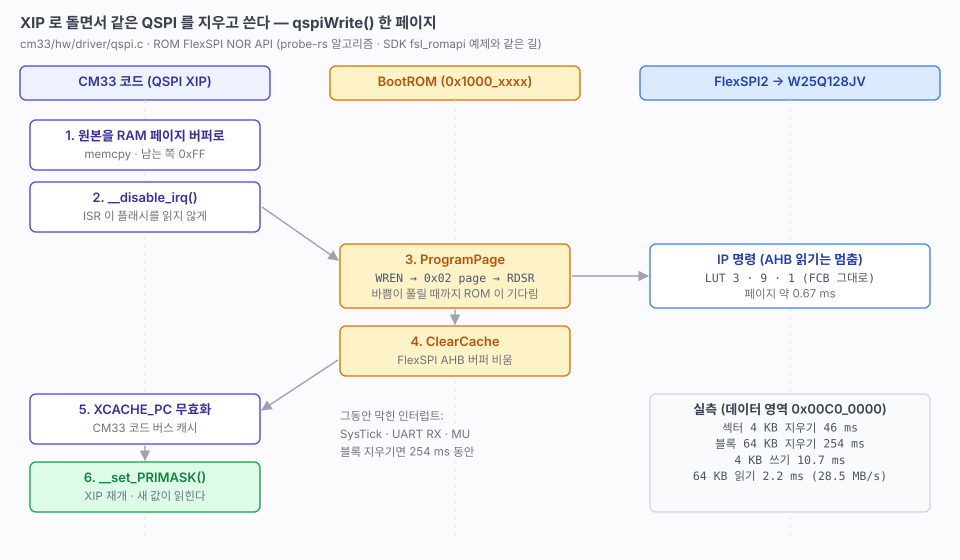

# 26. QSPI NOR 드라이버 — XIP 로 돌면서 지우고 쓰기

> CM33 이 자기가 돌고 있는 QSPI(W25Q128JV)를 지우고 쓰는 드라이버. 부트로더(40~43), NVS, 펌웨어 업데이트의 전제다.
> 관련: [10-dev-environment.md](10-dev-environment.md) 6절 · [02-memory-map.md](02-memory-map.md) 5절 · [20-led.md](20-led.md) 3절 (FCB)
>
> 출처: SDK `RT1180/MIMXRT1189/drivers/romapi/fsl_romapi.{c,h}`, `_boards/frdmimxrt1186/driver_examples/fsl_romapi/flexspi_romapi.c`. W25Q128JV 데이터시트 값은 원문이 저장소에 없어 **확인 필요**로 둔다.



---

## 1. 결과

```
[OK] qspiInit()
     W25Q128JV  ID EF 40 18  16384 KB
cli# qspi test
erase sector 4 KB   : OK   46392 us
  blank check       : OK  (0 B not FF)
write 4 KB          : OK   10707 us
  verify            : OK  (0 B differ)
read 64 KB          : OK    2243 us  (28533 KB/s)
erase block 64 KB   : OK  253766 us
  blank check       : OK  (0 B not FF)
```

| 동작 | 실측 | W25Q128JV 데이터시트 (확인 필요) |
|---|---|---|
| 섹터 지우기 4 KB | 46 ms | 전형 45 ms, 최대 400 ms |
| 블록 지우기 64 KB | 254 ms | 전형 150 ms, 최대 2000 ms |
| 쓰기 4 KB (16 페이지) | 10.7 ms (페이지당 0.67 ms) | 페이지 전형 0.4 ms, 최대 3 ms |
| 읽기 64 KB (메모리 맵) | 2.2 ms, 28.5 MB/s | — |

- 지우고 쓰는 동안에도 CM33 은 같은 플래시에서 XIP 로 돌고 있었다.
- CM7 은 영향이 없었다(alive 계속 증가, `peer echo 512 100` 100/100).
- FlexSPI2 클럭은 그대로 99.3 MHz 다(`hwinfo clock`). ROM init 이 부팅 설정을 바꾸지 않는다.

## 2. 어떻게 — ROM 의 FlexSPI NOR API

FlexSPI 로 플래시에 쓰려면 IP 명령(쓰기 허가 → 지우기/페이지 쓰기 → 상태 읽기)을 보내야 한다. 그런데 **IP 명령이 도는 동안 FlexSPI 는 AHB 읽기(XIP)를 할 수 없다.** 그래서 지우고 쓰는 코드는 같은 플래시에서 돌면 안 된다.

길은 두 가지다.

| 방법 | 내용 | 고른 이유 |
|---|---|---|
| SDK `fsl_flexspi` + 직접 만든 LUT | 지우기/쓰기 함수를 TCM(`.ram_function`)에 두고 IP 명령을 직접 보낸다 | — |
| **BootROM 의 FlexSPI NOR API** | ROM 함수(`0x1000_xxxx`)가 IP 명령을 보내고 끝날 때까지 기다린다 | **채택.** ROM 은 플래시가 아니므로 XIP 와 부딪히지 않는다. probe-rs 플래시 알고리즘이 이미 보드에서 이 길로 써 왔다([10](10-dev-environment.md) 6절). SDK `fsl_romapi` 예제도 XIP 로 돌면서 같은 플래시를 지우고 쓴다 |

SDK `fsl_romapi` 를 들여왔다([11](11-sdk-vendoring.md)). 쓰는 함수는 다음과 같다.

| ROM API | 하는 일 |
|---|---|
| `ROM_API_Init()` | `*(0x1000_001C)` 에서 API 트리를 찾는다 |
| `ROM_FLEXSPI_NorFlash_Init(2, &cfg)` | FlexSPI2 를 설정 블록대로 다시 잡는다 |
| `..._EraseSector` / `..._EraseBlock` | LUT 5(0x20) / 8(0xD8) |
| `..._ProgramPage` | LUT 3(WREN) → 9(0x02) → 1(RDSR) |
| `..._UpdateLut` + `..._CommandXfer` | JEDEC ID(0x9F)를 비어 있는 LUT 7 에 넣고 읽는다 |
| `..._ClearCache` | FlexSPI AHB 버퍼를 비운다 |

### 설정 블록은 부팅에 쓴 FCB 를 그대로 쓴다

`ROM_FLEXSPI_NorFlash_Init()` 에는 512 B 설정 블록(`flexspi_nor_config_t`)이 필요하다. SDK 예제는 코드로 채우지만, 여기서는 **플래시 `0x0400_0400` 에 있는 우리 FCB 를 RAM 으로 복사해 넘긴다.**

- 부팅 때와 같은 LUT, 같은 클럭(100 MHz Quad)이 된다.
- 우리 FCB(`bsp/boot/boot_hdr.c`)는 SDK 예제와 같은 값이다. 지우기(5, 8, 11)와 쓰기(9) 시퀀스까지 들어 있다.
- 복사하기 전에 tag(`FCFB`)를 확인한다.

probe-rs 는 이 FCB 를 쓰지 않고 SFDP 로 설정을 만든다(옵션 `0xC000_0005`). 같은 플래시를 두 가지 설정으로 다루는 셈인데, 둘 다 같은 W25Q128JV 명령이라 결과는 같다.

## 3. XIP 와 부딪히지 않게 지킨 것

| 규칙 | 이유 | 코드 |
|---|---|---|
| **ROM 호출 동안 인터럽트를 막는다** | ISR 은 플래시에 있다. IP 명령 중에 ISR 이 명령어를 가져오면 잘못된 값을 읽는다 | `__disable_irq()` … `__set_PRIMASK()` |
| **쓰기 원본은 RAM 페이지 버퍼로 옮긴다** | ROM 이 원본을 읽는 동안 플래시는 IP 명령 중이다. 원본이 플래시(상수 등)에 있으면 깨진다 | `page_buf[256]` |
| 페이지를 다 채우지 않는 쪽은 0xFF | NOR 는 1 을 써도 바뀌지 않는다. 정렬되지 않은 쓰기를 그대로 처리한다 | `memset(page_buf, 0xFF, …)` |
| **지우고 쓴 뒤 캐시를 비운다** | FlexSPI AHB 버퍼와 CM33 코드 버스 캐시(`XCACHE_PC`)에 옛 값이 남는다 | `ROM_..._ClearCache()` + `XCACHE_PC` 무효화 |
| 읽기는 메모리 맵에서 | 캐시를 비운 뒤라 새 값이 읽힌다. ROM 읽기보다 빠르다 | `memcpy(0x0400_0000 + addr)` |

CM7 은 QSPI 를 쓰지 않으므로 신경 쓸 것이 없다. CM7 은 ITCM 에서 돈다.

## 4. API — `common/hw/include/qspi.h`

N657X0 의 `xspi.h`, 예전 저장소들의 `qspi.h` 와 같은 모양이다. **주소는 플래시 안의 오프셋**(0 ~ 16 MB)이다. 메모리 맵 주소는 `qspiGetAddr() + addr` 이다.

| 함수 | 비고 |
|---|---|
| `qspiInit()` · `qspiIsInit()` | ID 가 Winbond(0xEF)일 때 OK |
| `qspiRead(addr, p, len)` | 메모리 맵 memcpy |
| `qspiWrite(addr, p, len)` | 페이지 단위로 나눠 쓴다. 정렬 무관. **미리 지워져 있어야 한다** |
| `qspiErase(addr, len)` | 섹터 단위로 넓혀 지운다. 64 KB 로 맞는 구간은 블록 지우기로 한다 |
| `qspiEraseSector()` · `qspiEraseBlock()` | 4 KB · 64 KB |
| `qspiGetInfo()` · `qspiGetAddr()` · `qspiGetLength()` | |

칩 전체 지우기는 **넣지 않았다.** 돌고 있는 펌웨어까지 지운다. 펌웨어 영역을 지우지 않는 것은 부르는 쪽의 책임이다. 영역 검사는 그 위에 올릴 `flash` 층(부트로더, 로드맵 40)에서 한다.

## 5. CLI — `qspi`

```
qspi info                    ID, 크기, 섹터 · 블록 · 페이지
qspi read  addr [length]     hex 덤프 (어디든)
qspi erase addr length       ┐
qspi write addr data32       ├ 데이터 영역 0x00C0_0000 ~ 0x0100_0000 만
qspi test  [addr]            ┘ 64 KB 를 지운다
```

CLI 의 지우기와 쓰기는 **데이터 영역만** 허용한다([02](02-memory-map.md) 5절). 시험하다 부트 슬롯, 앱, CM7 슬롯을 지우지 않게 하려는 것이다.

```
cli# qspi erase 0x00000000 4096
E_ CLI 는 0x00C00000 ~ 0x01000000 만 지우고 쓴다
cli# qspi write 0x00C00010 0x12345678
write 0x00C00010 0x12345678 : OK
cli# qspi read 0x00C00000 32
0x00C00000 : FF FF FF FF FF FF FF FF FF FF FF FF FF FF FF FF
0x00C00010 : 78 56 34 12 FF FF FF FF FF FF FF FF FF FF FF FF
```

시간은 `micros()` 가 아니라 **DWT 사이클 카운터**로 잰다. 지우는 동안 인터럽트가 막혀 SysTick 이 밀리기 때문이다.

## 6. 알아 둘 것

- **인터럽트가 막히는 시간이 길다.** 섹터 지우기는 46 ms, 블록 지우기는 254 ms 동안 인터럽트가 막힌다(데이터시트 최대는 400 ms, 2 s 로 알고 있다. 확인 필요).
  - 그동안 **SysTick 이 멈춰 `millis()` 가 그만큼 늦어진다.**
  - **UART 수신 바이트를 잃을 수 있다.** LPUART FIFO 가 차면 넘친다.
  - CM33 쪽 MU 인터럽트(코어 간 메시지)도 늦게 처리된다.
- NVS 처럼 자주 쓰는 곳은 섹터(4 KB) 단위로 지우고, 지우기를 사용자 동작과 겹치지 않는 때에 한다.
- 부트로더(로드맵 41)는 TCM 에서 돌게 할 계획이다(non-XIP). 그러면 인터럽트를 막을 필요가 없어지고, ROM API 대신 직접 IP 명령을 보내도 된다.
- ROM API 는 `fsl_romapi.c` 를 통해 부른다. 이 파일은 CM7 빌드에도 들어가지만 CM7 은 부르지 않는다.

## 7. 사용 방침 — XIP 중 쓰기는 제한적으로

XIP 로 돌면서 쓰는 것은 **가끔, 시점을 고를 수 있을 때만** 한다. 인터럽트가 수십~수백 ms 막히기 때문이다(6절).

| 써도 된다 | 쓰지 않는다 |
|---|---|
| 드물게, 사용자 조작이나 명령으로 일어나는 작은 쓰기 (설정 저장 등, 섹터 1~2 개) | 펌웨어 업데이트처럼 큰 영역 지우기 (블록 하나에 254 ms) |
| 부팅 직후, 통신이 없는 때처럼 시점을 고를 수 있는 쓰기 | 통신 중, 주기 제어 중의 쓰기 |

대신 이렇게 나눈다.

1. **업데이트는 부트로더가 한다**(로드맵 41~43). 부트로더는 TCM 에서 돌아(non-XIP) 인터럽트를 막을 필요가 없다. 앱은 업데이트 영역에 쓰지 않는다.
2. **끊기면 안 되는 일은 CM7 에 둔다.** CM7 은 ITCM 에서 돌아 CM33 이 지우는 동안에도 영향이 없었다(1절).
3. **아주 작은 값은 BBNSM GPR 에 둔다**(리셋 원인처럼, [24](24-rtc-reset.md)). 전원이 꺼지면 사라지지만 지우기가 없다.
4. 정말 필요하면 **지우기 일시정지**(W25Q128JV Erase Suspend `0x75` / Resume `0x7A`)로 지우는 도중 인터럽트를 처리한다. ROM API 에는 없어 IP 명령을 직접 다뤄야 한다. 필요할 때 검토한다.

NVS 를 어떻게 할지(어느 영역, 몇 섹터, 언제 지울지, 이 방침과 어떻게 맞출지)는 그 단계에서 다시 정한다.

## 8. 다음

- [ ] `flash` 층 — 영역(부트로더 / 앱 / CM7 / 데이터) 검사를 둔 래퍼 (로드맵 40)
- [ ] NVS — 설계는 그 단계에서 정한다 (7절 방침을 따른다)
- [ ] 지우는 동안 UART 수신을 잃지 않게 — 지우기를 쪼개거나, 부트로더처럼 TCM 실행으로 바꾸기
