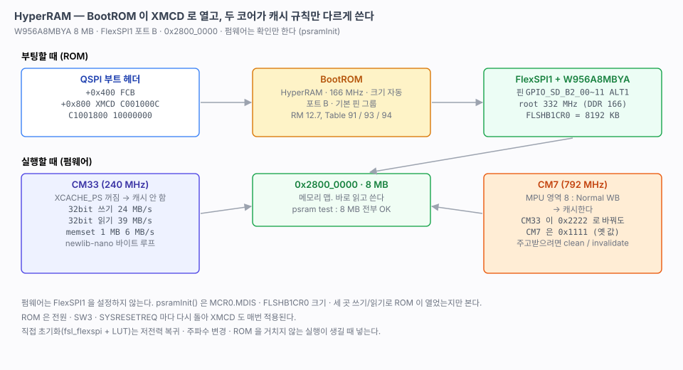

# 27. HyperRAM — XMCD 로 BootROM 이 연다

> 보드의 HyperRAM 8 MB(W956A8MBYA, FlexSPI1)를 `0x2800_0000` 에 붙인다. 설정은 BootROM 이 부트 헤더의 XMCD 를 보고 하고, 펌웨어는 확인과 시험만 한다.
> 관련: [02-memory-map.md](02-memory-map.md) · [03-board-mapping.md](03-board-mapping.md) 6절 · [25-cm7-boot.md](25-cm7-boot.md) 9절 (CM7 MPU) · [26-qspi-nor.md](26-qspi-nor.md)
>
> 출처: RM 12.7 External Memory Configuration Data (Table 90~94), SDK `frdmimxrt1186_flexspi_nor_config.c` (`USE_HYPERRAM`), `frdmimxrt1186_hyperram_txt_cm33.ini`, `driver_examples/flexspi/hyper_ram/polling_transfer`.



---

## 1. 결과

```
[OK] psramInit()
     HyperRAM  8192 KB @ 0x28000000 (XMCD)
cli# psram test
data bus (walking 1) : OK
addr bus (2^n)       : OK
full 8192 KB (addr, ~addr) : OK  (0 words differ)
  write 32bit loop   :  341122 us  (24014 KB/s)
  read  32bit loop   :  211154 us  (38796 KB/s)
  memset 1 MB        :  166052 us  (6166 KB/s)
  memcpy 1 MB        :  172420 us  (5938 KB/s)
```

- 8 MB 전체를 주소 값과 그 반전으로 두 번 채워 비교했다. 불일치는 0 이다. (5절에서 코어별로 나눈 뒤로 `psram test` 는 CM33 몫만 시험한다.)
- FlexSPI1 루트 클럭은 332 MHz 다. HyperRAM 은 DDR 이라 166 MHz 로 돈다.

## 2. 왜 XMCD 인가

HyperRAM 을 붙이는 길은 두 가지다.

| 방법 | 내용 |
|---|---|
| **XMCD** (채택) | 부트 헤더 `+0x800` 에 3 워드를 적는다. **BootROM 이 부팅할 때** 핀 · 클럭 · LUT 를 잡고 크기를 자동으로 감지한다. SDK 보드의 `USE_HYPERRAM` 빌드와 같다 |
| SDK `fsl_flexspi` | 펌웨어가 핀 11 개, 클럭, LUT(읽기 0xA0 · 쓰기 0x20 · 레지스터 0xE0/0x60)를 직접 설정한다. `hyper_ram/polling_transfer` 예제 |

우리 링커와 부트 헤더에는 처음부터 XMCD 자리(`.boot_hdr.xmcd_data`, `0x0400_0800`)가 비어 있었다([20](20-led.md) 3절). 3 워드만 채우면 되고, 핀 · 클럭 설정을 펌웨어가 가질 필요가 없다.

### XMCD 값 (`bsp/boot/boot_hdr.c`)

| 워드 | 값 | 필드 (RM Table 91 / 93 / 94) |
|---|---|---|
| 헤더 | `0xC001000C` | tag `C`, FlexSPI, **인스턴스 1**, 간이 설정 블록, 크기 12 B |
| 옵션 0 | `0xC1001800` | tag `C`, 옵션 2 워드, **HyperRAM**, single-ended 클럭, **166 MHz**, 크기 0 = 자동 |
| 옵션 1 | `0x10000000` | **포트 B**, DQS · 핀 그룹 기본(primary), 더미 사이클 자동 |

XMCD CRC 검사는 퓨즈(`BOOT_CFG7[20] XMC_CRC32_CHECK_EN`)가 0 이라 하지 않는다.

### ROM 이 잡은 것 (보드에서 읽음)

| 항목 | 값 |
|---|---|
| FlexSPI1 `MCR0` | `0xFFFF_A030` (MDIS = 0, 켜짐) |
| 포트 B1 크기 `FLSHB1CR0` | `0x2000` KB = **8 MB** (자동 감지) |
| 핀 | `GPIO_SD_B2_00~03 · 05~11` mux ALT1(FLEXSPI1 포트 B). DQS(`SD_B2_05`)와 SCLK(`SD_B2_07`)는 SION 까지 `0x11` |
| 루트 클럭 | 332 MHz (`psram info`) |

`SD_B2_04` 는 mux 5(GPIO, 리셋 기본값) 그대로다. ROM 이 잡지 않는다. SDK 디버그 스크립트(`.ini`)의 핀 목록에도 없다.

## 3. 펌웨어는 확인만 한다 — `psram.c`

`psramInit()` 은 FlexSPI1 을 **설정하지 않는다.** ROM 이 열어 두었는지만 본다.

1. `FLEXSPI1->MCR0` 의 MDIS 가 0 인지(켜졌는지)
2. `FLSHCR0[B1]` 에 크기가 적혔는지. 이 값을 `psramGetLength()` 로 쓴다
3. 처음 · 가운데 · 끝 워드에 두 패턴을 써서 읽어 본다(원래 값은 되돌린다)

ROM 이 설정하지 않았으면 `[E_] psramInit()` 으로 드러난다. API 는 예전 저장소(Teensy41 의 RT1062 PSRAM 등)의 `psram.h` 와 같다: `psramInit` · `psramIsInit` · `psramGetAddr` · `psramGetLength`.

### 직접 초기화는 언제 필요한가

ROM 은 전원 재인가 · SW3(POR_B) · SYSRESETREQ(`probe-rs` 리셋, 소프트 리셋)마다 다시 돌아 XMCD 도 매번 적용된다. 그래서 지금은 직접 초기화가 필요 없다. 다음 경우에는 `fsl_flexspi` + LUT 로 직접 초기화를 넣는다.

- 저전력 모드에서 FlexSPI1 · HyperRAM 전원을 내렸다 올릴 때
- 주파수나 타이밍을 실행 중에 바꿀 때 (XMCD 는 166 MHz 고정)
- ROM 을 거치지 않는 실행 경로가 생길 때 (디버거로 RAM 에 바로 올려 실행 등)

## 4. 두 코어의 캐시 규칙

| | CM33 | CM7 |
|---|---|---|
| 캐시 | **하지 않는다.** 시스템 버스 캐시 `XCACHE_PS` 가 꺼져 있다([25](25-cm7-boot.md) 9절) | **한다.** MPU 영역 8 `0x2800_0000` 8 MB Normal write-back (`cm7/bsp/mpu.c`) |
| 결과 | 바이트 접근마다 버스를 탄다. newlib-nano 의 `memset` · `memcpy` 는 크기 우선이라 바이트 루프여서 6 MB/s 다. 32 bit 루프는 24 / 39 MB/s | 빠르지만 CM33 이 쓴 값을 늦게 본다 |

### CM7 캐시 확인 (`peer read`)

CM7 이 직접 읽도록 cmd 명령 `SHARED_CMD_MEM_READ` 와 CLI `peer read addr` 을 더했다([25](25-cm7-boot.md) 11절의 패킷 통신을 쓴다).

| 순서 | 메모리 실제 값 | CM7 이 읽은 값 |
|---|---|---|
| CM33 쪽에서 `0x2820_0000` 에 `0x11111111` 을 씀 | `0x11111111` | `0x11111111` — 이때 캐시에 줄이 들어온다 |
| CM33 쪽에서 `0x22222222` 로 바꿈 | `0x22222222` | **`0x11111111`** — 캐시에 남은 옛 값 |
| 공유 블록 `0x2050_0000` (non-cacheable) | magic | `0x48535452` — 그대로 맞다 |

**HyperRAM 으로 두 코어가 데이터를 주고받으려면 CM7 쪽이 캐시를 다뤄야 한다.**

- CM7 이 쓴 것을 CM33 이 읽게 하려면, 쓴 뒤 `SCB_CleanDCache_by_Addr()` 를 부른다.
- CM33 이 쓴 것을 CM7 이 읽게 하려면, 읽기 전에 `SCB_InvalidateDCache_by_Addr()` 를 부른다.
- 구간은 32 B(캐시 줄) 단위로 맞춘다.
- 아니면 주고받는 구간만 MPU 로 non-cacheable 로 따로 잡는다.

코어 간 신호와 작은 데이터는 지금처럼 OCRAM2 공유 블록(non-cacheable)과 cmd 패킷으로 하고, HyperRAM 에는 큰 버퍼를 두고 위치만 패킷으로 넘긴다([25](25-cm7-boot.md) 11절).

## 5. 두 코어의 몫과 `.psram_bss` 섹션

### SDK 는 어떻게 하나

SDK 는 섹션을 따로 두지 않는다. **링커 스크립트를 통째로 바꾼 빌드 변형** `*_flexspi_nor_hyperram.ld` 가 있고, 일반판과의 차이는 `m_data`(`.data` `.bss` 힙 스택) 전체를 TCM 대신 HyperRAM 으로 옮기는 것뿐이다. 빠르게 써야 하는 것만 `DataQuickAccess` 로 TCM 에 남긴다. `.data` 초기값을 startup 이 HyperRAM 으로 복사하므로 XMCD 로 ROM 이 미리 열어 두는 것이 전제다.

| 코어 | SDK 링커 | |
|---|---|---|
| CM7 | `m_hyperram_start = 0x2800_0000`, `size = 6 MB` | *"Reserved 2M for CM33 usage"* |
| CM33 | `0x2860_0000`, 2 MB (dual image) / 8 MB 전체 (단일 코어) | |

### 여기서는 섹션으로 큰 버퍼만 둔다

TCM 이 충분하고 CM33 은 HyperRAM 을 캐시하지 않아 느리다(32 bit 읽기 39 MB/s). 그래서 SDK 처럼 변수와 스택을 통째로 옮기지 않고, **표시한 큰 버퍼만** HyperRAM 에 둔다. 나누는 비율은 SDK 와 같게 했다(나중에 SDK 코드를 가져올 때 주소가 맞는다).

| 코어 | 링커 `PSRAM` 영역 | 섹션 |
|---|---|---|
| CM7 | `0x2800_0000`, 6 MB | `.psram_bss` |
| CM33 | `0x2860_0000`, 2 MB | `.psram_bss` |

```c
#include "psram.h"

static uint8_t frame_buf[512 * 1024] PSRAM_BSS;    // section(".psram_bss"), aligned(32)
```

- **NOLOAD.** 기록할 때 probe-rs 가 이 구간을 건드리지 않는다. 리셋 뒤 ROM 이 다시 열기 전에는 HyperRAM 에 접근할 수 없으므로 중요하다.
- **0 채우기는 `psramInit()` 이 확인한 뒤**에 한다. startup 의 `.bss` 클리어는 TCM 만 지운다. startup 에서 HyperRAM 을 지우면 ROM 이 열지 않았을 때 로그도 남기기 전에 멈춘다. 그래서 **PSRAM_BSS 변수는 `hwInit()` 의 `psramInit()` 이후에 쓴다.**
- **32 B 정렬.** CM7 캐시 줄 단위라 clean / invalidate 를 다른 변수와 나눠 하지 않는다.
- 초기값이 있는 `.data` 는 두지 않는다(플래시에서 복사하는 코드가 따로 필요하다).
- CM7 도 같은 API 의 작은 `psram.c` 가 FlexSPI1 이 켜졌는지만 보고 자기 섹션을 0 으로 채운다.
- `psramGetAddr()` · `psramGetLength()` 는 이제 **이 코어 몫**이다.

### 확인

임시로 두 코어에 `PSRAM_BSS` 변수를 하나씩 두고 확인했다(확인 뒤 지웠다).

| 확인 | CM33 | CM7 |
|---|---|---|
| 변수 주소 (맵) | `0x2860_0000` | `0x2800_0000` |
| 리셋 전에 디버거로 `0xAA` 채움 | `aaaaaaaa` | `aaaaaaaa` |
| 부팅 뒤 | `00000000` | `00000000` |

```
[OK] psramInit()
     HyperRAM  8192 KB, CM33 2048 KB @ 0x28600000 (bss 4096 B)
cli# psram test
full 2044 KB (addr, ~addr) : OK  (0 words differ)
```

`psram test` 는 CM33 몫에서 **bss 뒤만** 덮어쓴다. 시험 뒤에도 bss 첫 워드(`0x2860_0000`)와 CM7 몫의 마지막 워드(`0x285F_FFFC`)에 넣어 둔 값이 그대로 남았다.

## 6. CLI

```
psram info     init, 칩 크기(FLSHB1CR0), CM33 몫, bss 구간, FlexSPI1 MCR0 · 루트 클럭
psram test     데이터 버스, 주소 버스, CM33 몫 전체 비교, 속도  ← CM33 몫의 bss 뒤를 덮어쓴다
peer read addr CM7 이 그 주소를 읽는다 (CM7 의 캐시를 거친다)
```

## 7. 다음

- [ ] CM33 `XCACHE_PS` 를 켤지 정한다. 켜면 HyperRAM 이 빨라지지만 OCRAM2 공유 블록도 캐시되므로, CM33 MPU 로 공유 구간을 non-cacheable 로 먼저 잡아야 한다
- [ ] newlib-nano 대신 워드 단위 `memcpy` · `memset` 을 쓸지 정한다 (HyperRAM · OCRAM 같은 느린 메모리에서 차이가 크다)
- [x] 링커에 HyperRAM 섹션(`.psram_bss`, NOLOAD)을 둔다 — 5절. CM7 6 MB / CM33 2 MB
