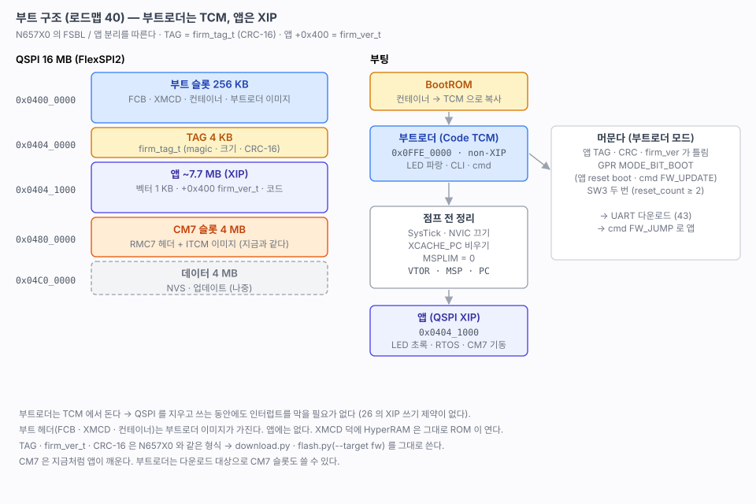

# 40. 부트 구조 — 부트로더와 앱을 나누기 (설계)

> 부트로더(`firmware/rt1180-boot`)와 앱(`firmware/rt1180-fw`)을 나누는 설계. 파티션, 실행 위치, TAG 형식, 부트로더에 머무는 조건, 앱으로 넘어가는 절차를 정한다. **이 문서는 설계다.** 41(골격) · 42(TAG 검증 · 점프) · 43(UART 다운로드)에서 구현하며 확인한다.
> 관련: [02-memory-map.md](02-memory-map.md) 5절 (파티션 계획) · [24-rtc-reset.md](24-rtc-reset.md) (부트 모드 · 더블클릭) · [26-qspi-nor.md](26-qspi-nor.md) 7절 (XIP 중 쓰기 방침) · [27-hyperram.md](27-hyperram.md) (XMCD)
>
> 출처: NUCLEO-N657X0 `docs/29-app-split.md` · `stm32n6-boot/src/ap/modules/boot/boot.c` · `tools/flash.py` · `tools/download.py`, RM 12.5.1.2 (non-XIP 부팅).

---

## 1. 무엇을 정하나

| 항목 | 정한 것 | 근거 |
|---|---|---|
| 프로젝트 | **부트로더를 별도 프로젝트** `firmware/rt1180-boot` 로. 지금의 `rt1180-fw` 는 앱이 된다 | N657X0 (`stm32n6-boot` / `stm32n6-fw`) |
| 부트로더 실행 위치 | **CM33 Code TCM `0x0FFE_0000` (non-XIP)**. ROM 이 컨테이너를 보고 QSPI 에서 TCM 으로 복사해 실행한다 | RM 12.5.1.2: *"For non-XIP boot, the image can be built to execute from internal RAM."* 예약 OCRAM 과 `0x0000_0000` 근처만 피하면 된다 |
| 부트로더 구성 | **RTOS 없음** (bare-metal) + module · cli · cmd · qspi · rtc · reset · led · uart · log | N657X0 FSBL 과 같다. 작고 단순하게 |
| 앱 실행 위치 | QSPI **XIP** `0x0404_1000` | 지금과 같다 (주소만 옮긴다) |
| TAG | `firm_tag_t` (N657X0 와 같다) — CRC-16 | `download.py` · `flash.py` 를 그대로 쓴다 |
| 앱 정보 | 앱 이미지 `+0x400` 에 `firm_ver_t` | 우리 벡터 테이블이 정확히 `0x400` B 다 (링커 `VECTORS`) |

## 2. 파티션 (확정)

[02](02-memory-map.md) 5절의 계획을 그대로 확정한다.

| 주소 | 크기 | 내용 | 누가 쓰나 |
|---|---|---|---|
| `0x0400_0000` | 256 KB | **부트 슬롯** — FCB(`+0x400`) · XMCD(`+0x800`) · 컨테이너(`+0x1000`) · 부트로더 이미지 | probe-rs (개발), 부트로더 자체 업데이트는 나중 |
| `0x0404_0000` | 4 KB | **TAG** (`firm_tag_t`) | 부트로더 (다운로드 마지막에 쓴다) · `flash.py` |
| `0x0404_1000` | ~7.7 MB | **앱** — 벡터 1 KB · `+0x400` `firm_ver_t` · 코드 (XIP) | 부트로더 · probe-rs |
| `0x0480_0000` | 4 MB | **CM7 슬롯** — `RMC7` 헤더 + ITCM 이미지 (지금과 같다) | 부트로더 · probe-rs. 앱이 읽어 CM7 을 깨운다 |
| `0x04C0_0000` | 4 MB | 데이터 (NVS · 업데이트 임시) | 나중에 정한다 ([26](26-qspi-nor.md) 7절) |

- 부트 헤더(FCB · XMCD · 컨테이너)는 **부트로더 이미지가 가진다.** 앱 이미지에는 없다.
- XMCD 가 부트 헤더에 그대로 있으므로 HyperRAM 은 지금처럼 ROM 이 연다([27](27-hyperram.md)). 앱은 손댈 것이 없다.
- 부트로더 이미지는 Code TCM(128 KB)에 들어가야 한다. 데이터 · 스택은 System TCM(128 KB).

## 3. 왜 부트로더를 TCM 에서 돌리나

[26](26-qspi-nor.md) 에서 XIP 로 돌면서 QSPI 를 지우고 쓰면 그동안 **인터럽트를 막아야** 했다(섹터 46 ms, 블록 254 ms). 업데이트처럼 큰 영역을 지울 때는 견디기 어렵다(26 7절 방침).

부트로더가 TCM 에서 돌면 코드와 ISR 이 플래시에 없다. ROM API 로 지우고 쓰는 동안에도 UART 수신 · SysTick 인터럽트가 그대로 돈다. **업데이트는 부트로더가 하고 앱은 업데이트 영역에 쓰지 않는다** — 26 7절 방침의 1 번이다.

## 4. 부트로더에 머무는 조건

N657X0 FSBL 과 같다. 판정은 `apInit()` 에서 모듈을 열기 **전에** 한다. 앱으로 갈 때는 CLI · cmd 를 열지 않는다.

| 상황 | 판정 | 결과 |
|---|---|---|
| 전원 · 리셋, 앱이 맞다 | TAG(magic · tag_crc) → 이미지 CRC-16 → `firm_ver_t` | 앱으로 점프 |
| 앱에서 `reset boot` · cmd `FW_UPDATE` | BBNSM GPR `MODE_BIT_BOOT` ([24](24-rtc-reset.md)) | 머문다 (boot request) |
| SW3(POR_B) 두 번 (300 ms 안) | `reset_count ≥ 2` ([24](24-rtc-reset.md)) | 머문다 (reset double click) |
| 앱이 없거나 깨짐 | 위 판정 실패 | 머문다 (no valid app) |
| 부트로더에서 cmd `FW_JUMP` | TAG 확인 | 응답 뒤 앱으로 |

- 리셋 원인 기록은 부트로더가 한다(`HW_RESET_BOOT 1`). 앱은 `HW_RESET_BOOT 0` 으로 바꿔 부트로더가 GPR 에 남긴 것을 읽는다. `hw_def.h` 주석에 이미 그렇게 적어 두었다.
- LED: 부트로더 파랑, 앱 초록 (N657X0 와 같은 약속).

## 5. 앱으로 넘어가는 절차 (`bootJumpTo`)

N657X0 의 목록을 이 칩에 맞췄다.

| 할 일 | 이유 |
|---|---|
| UART · 쓰던 주변장치 닫기 | 앱이 다시 연다. 열린 채로 넘기면 앱 초기화와 부딪힌다 |
| SysTick 끄기, NVIC 전부 끄고 대기 지우기 | 앱이 VTOR 를 옮기기 전에 남은 인터럽트가 뜨면 부트로더(TCM) 핸들러로 간다 |
| `XCACHE_PC` 무효화 · FlexSPI AHB 버퍼 비우기 | 부트로더가 방금 앱을 썼다. 코드 버스 캐시에 옛 내용이 있을 수 있다 ([26](26-qspi-nor.md) 3절과 같은 이유) |
| 부트로더가 MPU · `XCACHE_PS` 를 켰다면 끄기 | 앱의 `mpuInit()` 이 처음부터 다시 잡는다 |
| `MSPLIM = 0` | 부트로더 스택 하한이 남아 있으면 앱 스택에서 바로 STKOF 폴트 (N657X0 와 같은 함정) |
| `VTOR = 0x0404_1000`, `MSP = 벡터[0]`, `PC = 벡터[1]` | |

FlexSPI2 는 ROM 이 부팅할 때 우리 FCB 로 잡아 둔 상태 그대로다. 부트로더는 FlexSPI 를 다시 설정하지 않는다(ROM API 의 init 도 같은 FCB 를 쓴다). 그래서 앱 XIP 가 그대로 된다.

## 6. 앱에서 바뀌는 것 (42)

| 바뀌는 것 | 내용 |
|---|---|
| 링커 | `FLASH` 시작 `0x0404_1000`. `FCB` · `XMCD` · `CONTAINER` 영역과 `boot_hdr.c` 는 부트로더로 옮긴다 |
| `firm_ver_t` | `hw.c` 에 둔다(`.version` 섹션, 벡터 바로 뒤 `+0x400`). `firm_addr` · `firm_size` 는 링커 심볼 |
| `hw_def.h` | `HW_RESET_BOOT 0`, 보드 이름 그대로 |
| cmd | `INFO`(mode = APP) · `FW_UPDATE` → `resetToBoot()`. 쓰기 · 지우기는 거부 (N657X0 `cmd_boot.c` 와 같다) |
| 클럭 · MPU · CM7 기동 | 지금처럼 앱이 한다. `clockInit()` 은 이미 켜진 PLL 을 다시 잡아도 되는지 42 에서 확인한다 |

## 7. 개발 흐름

| 할 일 | 방법 |
|---|---|
| 부트로더 기록 | `rt1180-boot` 의 `flash` 타깃 — probe-rs 로 elf (부트 슬롯) |
| 앱 기록 (디버거) | `rt1180-fw` 의 `flash` 타깃 — TAG + 앱 bin 을 `0x0404_0000` 에 (`flash.py --target fw` 처럼 PC 에서 TAG 를 만든다), CM7 슬롯, 리셋 |
| 앱 기록 (UART) | `download.py --target fw` — 앱이 돌고 있으면 `FW_UPDATE` 로 부트로더로 넘긴 뒤 쓴다 (43) |
| 앱 디버그 | VSCode `Flash + Attach` — 부트로더가 앱으로 점프한 뒤 붙는다 (CM7 과 같은 attach 방식, [14](14-cm7-debug.md)) |

## 8. 확인 필요 (41~43 에서)

- [x] ROM 이 컨테이너 load address 를 **CM33 Code TCM** 으로 받아 복사 · 실행하는지 — **NS `0x0FFE_0000` 으로 된다** ([41](41-bootloader.md))
- [x] non-XIP 컨테이너에서 ELE 가 이미지 해시를 검사하는지 — 해시 없이 부팅된다 ([41](41-bootloader.md))
- [x] 부트로더가 ROM API 로 QSPI 를 쓰는 동안 UART 수신이 끊기지 않는지 — 64 KB 지우는 동안 61 B 를 다 받았다. 앱(XIP)은 잃었다 ([43](43-uart-download.md) 7절)
- [x] 점프 뒤 앱 `SystemInit()` · `clockInit()` · `mpuInit()` 이 이미 설정된 상태에서 문제없는지 — 문제없다 ([42](42-app-jump.md) 5절)
- [x] probe-rs 로 TCM 에서 도는 부트로더를 디버그할 수 있는지 — gdb 로 붙어 PC `0x0FFE_xxxx` 를 읽고, `boot jump` 뒤 앱 브레이크포인트에서 멈췄다 ([42](42-app-jump.md) 5절)

## 9. 다음

- [x] 41 — `firmware/rt1180-boot` 골격: 컨테이너 load = Code TCM, LED 파랑, UART · CLI · 로그 ([41](41-bootloader.md))
- [x] 42 — TAG 검증과 점프, 앱을 `0x0404_1000` 으로 ([42](42-app-jump.md))
- [x] 43 — UART 다운로드 (cmd · `download.py`) ([43](43-uart-download.md))
