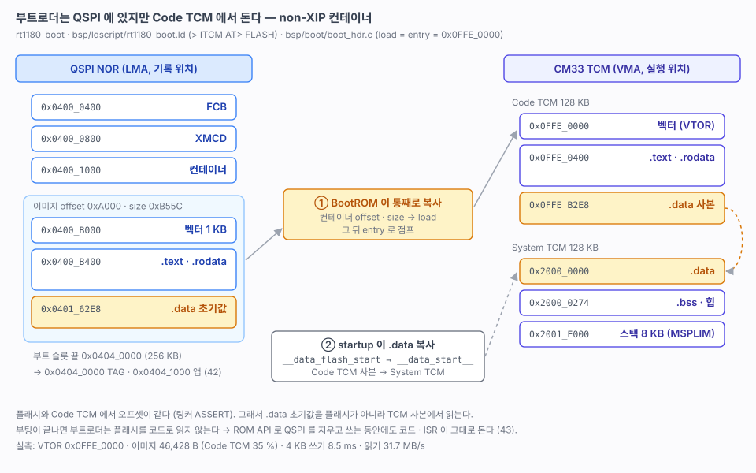

# 41. 부트로더 골격 — Code TCM 에서 도는 `rt1180-boot`

> [40](40-boot-architecture.md) 설계의 첫 단계. 별도 프로젝트 `firmware/rt1180-boot` 를 만들고, 컨테이너의 load · entry 를 CM33 Code TCM 으로 적어 ROM 이 부트로더를 TCM 으로 복사해 실행하게 했다(non-XIP). LED 파랑 · UART · CLI · 로그 · RTC · reset · QSPI 까지. TAG 검증과 점프는 42 에서 한다.
> 관련: [40-boot-architecture.md](40-boot-architecture.md) · [01-boot-sequence.md](01-boot-sequence.md) 4절 (컨테이너) · [26-qspi-nor.md](26-qspi-nor.md) · [12-project-skeleton.md](12-project-skeleton.md)
>
> 출처: RM 12.5.1.2 (non-XIP 부팅), RM 12.6.2 (컨테이너), NUCLEO-N657X0 `stm32n6-boot` (프로젝트 분리 방식).



---

## 1. 결과

```
[ Bootloader Begin... ]
Booting..Name           : FRDM-IMXRT1186-BOOT
Booting..Ver            : B261031R1
Booting..Clock          : 240 MHz
Booting..Mode           : 0x0C000000
Booting..Run            : 0x0FFE0000          ← VTOR = Code TCM
Booting..Clock Init     : PLL

[OK] qspiInit()
     W25Q128JV  ID EF 40 18  16384 KB
[OK] rtcInit()
[OK] resetInit()
cli#
```

- **ROM 이 NS 주소 `0x0FFE_0000` 을 받아 이미지를 Code TCM 으로 복사하고 거기서 실행했다.** S 주소(`0x1FFE_0000`)는 시험할 필요가 없었다.
- 서명 · 해시가 없는 컨테이너 그대로 부팅했다. XIP 때와 같다([01](01-boot-sequence.md) 4절).
- D4 가 **파랑**으로 500 ms 점멸한다(앱은 초록, [40](40-boot-architecture.md) 4절).

| 빌드 | 크기 |
|---|---|
| FLASH (부트 슬롯 이미지) | 46,428 B / 212 KB |
| Code TCM | 45,800 B / 128 KB (35 %) |
| System TCM | 23,392 B / 128 KB (스택 8 KB · 힙 4 KB 포함) |

## 2. 프로젝트 — 소스는 복사하지 않고 경로로

N657X0 는 부트로더 프로젝트에 드라이버를 복사해 두었다. 여기서는 앱과 같은 파일을 CMake 경로로 가져온다. 드라이버를 고치면 두 쪽이 같이 바뀐다.

```
firmware/rt1180-boot/
├── CMakeLists.txt          툴체인은 ../rt1180-fw/tools, flash 타깃 포함
├── prj/rt1180-boot.code-workspace
└── src/
    ├── main.c · main.h     bspInit → hwInit → apInit → apMain (RTOS 없음)
    ├── ap/ap.c             LED 파랑 500 ms, cliMain()
    ├── bsp/bsp.c · bsp.h   clockInit, SysTick 1 ms, delay/millis/micros
    ├── bsp/boot/boot_hdr.c FCB · XMCD · 컨테이너 (load = entry = Code TCM)
    ├── bsp/ldscript/rt1180-boot.ld
    └── hw/hw.c · hw.h · hw_def.h
```

| 앱(`rt1180-fw/src`)에서 가져오는 것 | |
|---|---|
| `common/` · `lib/` (CMSIS, NXP SDK) | 헤더 · qbuffer · util |
| `cpu/cm33/bsp/clock.c` · `syscalls.c` | 클럭은 앱과 같은 240 MHz |
| `cpu/cm33/hw/driver/` | led · uart · cli · log · rtc · reset · qspi · hw_info |
| SDK 드라이버 | common · clock · pmu · dcdc · rgpio · lpuart · romapi (pwm · mu 는 빼고) |
| startup · `SystemInit` | SDK 원본 그대로 |

### 인클루드 순서 — 부트로더 `hw_def.h` · `bsp.h` 가 잡히게

인클루드 경로는 부트로더 `src/hw`, `src/bsp` 를 앱 폴더보다 먼저 둔다. 드라이버가 `#include "hw_def.h"` 하면 부트로더 것이 잡힌다. 앱의 `hw/` 폴더는 경로에 넣지 않는다.

**하나 걸렸다.** 따옴표 인클루드는 경로보다 **그 소스 파일이 있는 폴더**를 먼저 찾는다. 앱의 `clock.c` 는 `#include "bsp.h"` 로 옆에 있는 앱 `bsp.h` 를 잡고, 그 안의 `#include "rtos.h"` 에서 멈췄다. 앱 `bsp.h` 를 이렇게 바꿨다.

```c
#if __has_include("rtos.h")
#include "rtos.h"
#endif
```

### 앱 쪽에서 바뀐 것

| 파일 | 내용 |
|---|---|
| `cm33/bsp/bsp.h` | 위의 `__has_include` |
| `cm33/hw/driver/led.c` | `_USE_HW_PWM` 이 없으면 녹색도 GPIO 채널로 (`LED_GREEN_TYPE`). 부트로더에는 pwm 이 없다 |

앱 빌드 결과는 바뀌지 않았다(FLASH 74,392 B).

## 3. 링커 — 실행은 TCM, 기록은 플래시

모든 이미지 섹션을 `> ITCM AT> FLASH` 로 둔다. 주소(VMA)는 Code TCM, 기록 위치(LMA)는 플래시다. probe-rs 와 `objcopy -O binary` 는 LMA 를 쓰므로 플래시 부트 슬롯에 들어가고, 디버거 심볼은 TCM 주소를 가리킨다.

```
.interrupts   VMA 0x0FFE_0000   LMA 0x0400_B000   벡터 1 KB
.text         VMA 0x0FFE_0400   LMA 0x0400_B400   코드 · rodata (CodeQuickAccess · .ramfunc 도 여기)
.ARM ~ .fini_array              (같은 오프셋)
.data         VMA 0x2000_0000   LMA 0x0401_62E8   초기값은 이미지 끝
.bss · 힙 · 스택  System TCM (NOLOAD)
```

| 심볼 | 값 | 쓰는 곳 |
|---|---|---|
| `__VECTOR_TABLE` = `ADDR(.interrupts)` | `0x0FFE_0000` | 컨테이너 load · entry |
| `__CONTAINER_IMG_OFFSET` | `0xA000` | 컨테이너 offset (이미지 LMA − 컨테이너) |
| `__CONTAINER_IMG_SIZE` | `0xB55C` | 벡터부터 **.data 초기값 끝까지** |
| `__data_flash_start` | `0x0FFE_B2E8` | startup 의 .data 복사 원본 |

**`.data` 초기값은 플래시가 아니라 TCM 사본에서 복사한다.** ROM 이 이미지 전체(.data 초기값 포함)를 Code TCM 으로 옮기므로, 플래시와 TCM 에서 오프셋이 같다. 그래서

```
__data_flash_start = ORIGIN(ITCM) + (LOADADDR(.data) - LOADADDR(.interrupts))
```

로 두면 startup 은 플래시를 한 번도 읽지 않는다. 오프셋이 같다는 것은 링커 `ASSERT` 로 지킨다(Code TCM 과 플래시가 둘 다 4 KB 정렬이라 섹션 정렬이 어긋나지 않는다). 이미지가 128 KB 를 넘어도 `ASSERT` 에서 멈춘다.

`__STARTUP_INITIALIZE_RAMFUNCTION` 은 정의하지 않는다. 코드 전체가 이미 TCM 에 있다.

컨테이너 바이트 (`build/rt1180-boot.bin` 0xC00 = 0x0400_1000):

```
00a0 0087 ...                  header : length 0xA0, tag 0x87, 이미지 1 개
00a0 0000 5cb5 0000            offset 0xA000 · size 0xB55C
0000 fe0f 0000 0000            load  0x0FFE_0000
0000 fe0f 0000 0000            entry 0x0FFE_0000
1302 0000                      flags 0x213 (실행 · CM33 · SHA512)
```

`boot_hdr.c` 는 앱 것과 코드가 같다. 링커 심볼의 값만 다르다.

## 4. bsp — RTOS 없이

| | 앱 | 부트로더 |
|---|---|---|
| 스케줄 | FreeRTOS (main 스레드) | 없음. `apMain()` 루프에서 `cliMain()` |
| 틱 | FreeRTOS 포트의 SysTick | `bspInit()` 의 `SysTick_Config()` 1 ms |
| 클럭 | `clockInit()` | 같은 함수 |
| MPU · XCACHE_PS | `mpuInit()` | **켜지 않는다** — TCM 만 쓰므로 필요 없고, 점프할 때 되돌릴 것이 줄어든다 ([40](40-boot-architecture.md) 5절) |
| `HW_RESET_BOOT` | 1 (42 에서 0) | 1 — 리셋 원인 · 더블클릭 기록은 부트로더 몫 |

`SystemInit()` 은 XCACHE_PC 를 켠다. TCM 실행에는 영향이 없고, 부트로더가 QSPI 를 읽을 때(`qspi read`, 42 의 CRC)만 쓰인다.

## 5. QSPI — TCM 에서 같은 시험

`qspi test` (0x00C0_0000, [26](26-qspi-nor.md) 1절과 같은 시험):

| | XIP (앱, 26) | Code TCM (부트로더) |
|---|---|---|
| 섹터 지우기 4 KB | 46 ms | 47 ms |
| 쓰기 4 KB | 10.7 ms | **8.5 ms** |
| 읽기 64 KB | 28.5 MB/s | **31.7 MB/s** |
| 블록 지우기 64 KB | 254 ms | 248 ms |

지우기는 플래시가 정하므로 같다. 쓰기 · 읽기는 CPU 가 플래시에서 코드를 가져오지 않아 조금 빠르다.

`qspi.c` 는 아직 ROM 호출마다 인터럽트를 막는다(XIP 용, [26](26-qspi-nor.md) 3절). 부트로더에서는 막을 필요가 없다. UART 다운로드(43)에서 지우는 동안 수신을 받아야 하므로 그때 TCM 실행일 때는 막지 않도록 고친다.

## 6. 기록과 디버그

```bash
cd firmware/rt1180-boot
cmake -S . -B build -G Ninja
cmake --build build
cmake --build build --target flash        # 부트 슬롯만 쓴다 → D4 파랑 점멸
```

- **부트로더를 쓰면 부트 슬롯에 있던 앱(지금의 `rt1180-fw`, `0x0400_B000`)이 덮인다.** 42 에서 앱을 `0x0404_1000` 으로 옮길 때까지는 둘 중 하나만 돈다. 앱으로 돌아가려면 `rt1180-fw` 의 `flash` 를 다시 한다.
- VSCode 는 `firmware/rt1180-boot/prj/rt1180-boot.code-workspace`. 디버그 구성은 앱 CM33 것과 같고 elf · SVD 경로만 바꿨다.

## 7. 걸렸던 것

| 증상 | 원인 | 해결 |
|---|---|---|
| `clock.c` 컴파일에서 `rtos.h: No such file` | 따옴표 인클루드가 `clock.c` 옆의 앱 `bsp.h` 를 먼저 잡았다 | 앱 `bsp.h` 에 `__has_include` (2절) |
| 콘솔에 `boot flag` · `nor step` 같은 낯선 출력 | 맥에 다른 보드(N657X0)의 VCOM 도 붙어 있었다 | MCU-Link 쪽 포트(`/dev/cu.usbmodem…3`)로 |

## 8. 확인 필요

- [x] ROM 이 컨테이너 load address 로 Code TCM 을 받는지 — **NS `0x0FFE_0000` 으로 된다**
- [x] non-XIP 컨테이너에서 해시 검사 — 서명 · 해시 없이 부팅된다
- [ ] **전원을 껐다 켜서(POR)** 부팅. 지금은 probe-rs 소프트 리셋(SRSR `CM33_REQUEST`)으로만 확인했다. 소프트 리셋도 BootROM 부터 다시 돌기 때문에 같을 것으로 본다
- [ ] probe-rs 로 TCM 에서 도는 부트로더 디버그 (VSCode `Debug CM33` · 브레이크포인트)
- [ ] QSPI 를 지우는 동안 UART 수신 (43, 5절)

## 9. 다음

- [ ] 42 — TAG 검증과 점프. 앱을 `0x0404_1000` 으로 옮기고 `firm_ver_t` 를 넣고 `HW_RESET_BOOT 0`. 부트로더는 module 구조(boot · cmd)로
- [ ] 43 — UART 다운로드 (cmd · `download.py`)
