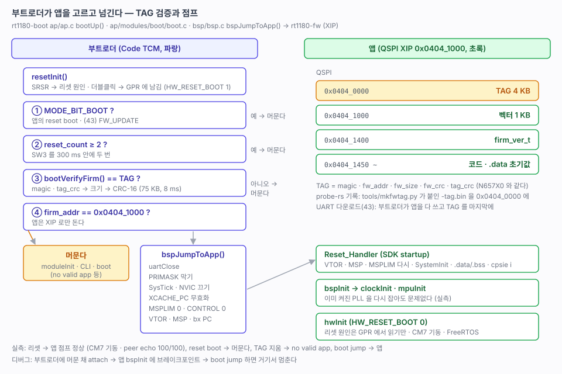

# 42. 앱 TAG 검증과 점프 — 부트로더 → 앱

> 부트로더(`rt1180-boot`)가 앱의 TAG 와 CRC 를 확인하고 `0x0404_1000` 의 앱으로 점프한다. 앱(`rt1180-fw`)은 부트 헤더를 내려놓고 TAG 뒤로 옮겼다. TAG 형식과 판정 순서는 NUCLEO-N657X0 FSBL 과 같다.
> 관련: [40-boot-architecture.md](40-boot-architecture.md) (설계) · [41-bootloader.md](41-bootloader.md) (부트로더 골격) · [24-rtc-reset.md](24-rtc-reset.md) (부트 모드 · 더블클릭) · [12-project-skeleton.md](12-project-skeleton.md)
>
> 출처: NUCLEO-N657X0 `stm32n6-boot/src/ap/ap.c` · `ap/modules/boot/boot.c` · `common/def.h` · `tools/flash.py`.



---

## 1. 결과

```
[ Bootloader Begin... ]
...
[OK] resetInit()
     SRSR : 0x00000200
     RESET_BIT_SOFT
     reset_count : 0
[  ] jump : XIP 0x04041000  FRDM-IMXRT1186-CM33 V261031R1


[ Firmware Begin... ]
Booting..Name           : FRDM-IMXRT1186-CM33
...
[OK] CM7 RUNNING (10 ms)
[OK] moduleInit()
[  ] Event EVENT_BOOT_DONE : 0
```

| 시험 | 결과 |
|---|---|
| 리셋 → 앱 | 점프. 앱에서 CM7 기동, `thread info`, `peer echo 512 100` 100/100 (591~709 µs) |
| 앱에서 `reset info` | `RESET_BIT_SOFT` — 부트로더가 GPR 에 남긴 것을 앱이 읽었다 (SRSR 은 부트로더가 지워서 0) |
| 앱에서 `reset boot` | `stay in bootloader (boot request)` |
| 부트로더 `boot info` | `ver` · `tag` · `img : TAG (실행 가능)`. CRC-16 75 KB 에 **8 ms** |
| 부트로더 `boot jump` | CLI 에서 바로 앱으로 (UART 를 닫았다가 앱이 다시 연다) |
| TAG 를 0xFF 로 지움 | `[E_] bootJumpFirm() - no valid image` → `stay in bootloader (no valid app)`, `img : VER` |
| 앱 `flash` 로 복구 | 다시 점프 |

## 2. 플래시 배치 — 확정한 그대로

| 주소 | 내용 | 누가 쓰나 |
|---|---|---|
| `0x0400_0000` | 부트 헤더 + 부트로더 (256 KB) | `rt1180-boot` 의 `flash` |
| `0x0404_0000` | **TAG** 4 KB (`firm_tag_t`) | 앱 `flash` (`-tag.bin`), 43 에서는 부트로더 |
| `0x0404_1000` | 앱 벡터 1 KB | 〃 |
| `0x0404_1400` | **`firm_ver_t`** (`.version`) | 〃 |
| `0x0404_1450` ~ | 앱 코드 · `.data` 초기값 (XIP) | 〃 |
| `0x0480_0000` | CM7 슬롯 | 앱 `flash` (그대로) |

## 3. 형식 — N657X0 와 같다

`common/def.h`:

```c
typedef struct
{
  uint32_t magic_number;      // "VER " 0x56455220
  char     version_str[32];
  char     name_str[32];
  uint32_t firm_addr;         // 링커 _fw_flash_begin = 0x0404_1000
  uint32_t firm_size;         // 링커 _fw_flash_size  = 벡터 ~ 마지막 로드 바이트   ← 이번에 추가
} firm_ver_t;

typedef struct
{
  uint32_t magic_number;      // "TAG " 0x54414720
  uint32_t fw_addr;           // TAG 크기 (0x1000) = 앱이 TAG 뒤 어디서 시작하는지
  uint32_t fw_size;
  uint32_t fw_crc;            // 벡터부터 fw_size 바이트의 CRC-16 (utilCalcCRC)
  uint32_t tag_crc;           // 앞 16 바이트의 CRC-16
} firm_tag_t;
```

- `firm_size` 는 C 에서 `end - begin` 을 계산하지 않고 **링커 심볼의 값**을 그대로 쓴다(`&_fw_flash_size`). N657X0 에서 링커가 0 으로 접어 버린 일이 있었다.
- CRC 는 펌웨어 `utilCalcCRC`(poly 0x8005, MSB first, 초기값 0)와 PC 쪽 `crc16()` 이 같다. 43 의 `download.py` 도 같은 함수를 쓴다.

## 4. 부트로더 — 판정 순서

`ap/ap.c` 의 `bootUp()` 은 `apInit()` 맨 앞에서 모듈을 열기 **전에** 판정한다. 앱으로 가면 CLI 를 열지 않는다.

| 순서 | 판정 | 결과 |
|---|---|---|
| ① | BBNSM GPR `MODE_BIT_BOOT` (앱의 `reset boot`) | 머문다 (boot request) |
| ② | `reset_count ≥ 2` (SW3 두 번, 300 ms) | 머문다 (reset double click) |
| ③ | `bootVerifyFirm()` — TAG magic · tag_crc → `firm_size == fw_size` → 이미지 CRC-16 | 실패면 머문다 (no valid app) |
| ④ | `firm_ver_t.firm_addr == 0x0404_1000` | 아니면 머문다 |
| | 모두 통과 | `bspJumpToApp(0x0404_1000)` |

- `firm_size != fw_size` 면 **옛 TAG** 로 본다. 앱만 새로 쓰고 TAG 를 그대로 둔 경우를 CRC 를 돌리기 전에 거른다(N657X0 와 같다).
- 부트로더는 앱과 같은 `module` 구조로 바꿨다. `ap/modules/boot`(`boot info` · `boot jump`), `ap/modules/common/cli`(RTOS 가 없으므로 스레드 대신 `update` 에서 `cliMain()`). `module.c` 는 앱 것을 경로로 가져온다. 43 에서 `cmd` 모듈이 더해진다.
- 머물 때 D4 는 파랑, 앱은 초록이다.

### 점프 — `bspJumpToApp()` (bsp/bsp.c)

레지스터를 만지는 일이라 `ap` 가 아니라 `bsp` 에 두었다. `boot.c` 는 로그를 남기고 `uartClose()` 를 부른 뒤 이 함수로 넘긴다.

| 할 일 | 이유 |
|---|---|
| `__disable_irq()` | 앱 startup 이 `.data` · `.bss` 를 마치고 `cpsie i` 로 연다 (SDK `startup_MIMXRT1186_cm33.S`). 그 사이 인터럽트가 뜨지 않는다 |
| SysTick 끄기 · 대기 지우기, NVIC `ICER` · `ICPR` 전부 | 남은 인터럽트가 부트로더(TCM) 핸들러로 가지 않게 |
| `XCACHE_PC` 무효화 | 부트로더가 방금 앱을 썼을 수 있다(43). 코드 버스 캐시의 옛 내용을 버린다 |
| `MSPLIM = 0`, `CONTROL = 0` | 부트로더 스택 하한(`0x2001_E000`)이 남으면 앱에서 STKOF 폴트 |
| `VTOR = 0x0404_1000`, `msr msp` · `bx` | MSP 를 바꾼 뒤에는 스택을 쓰면 안 되므로 마지막 두 명령은 인라인 어셈블리로 |

MPU · `XCACHE_PS` 는 부트로더가 켜지 않았으므로 되돌릴 것이 없다([41](41-bootloader.md) 4절).

## 5. 앱 — 바뀐 것

| 파일 | 바뀐 것 |
|---|---|
| `bsp/ldscript/rt1180-fw-cm33.ld` | `FCB` · `XMCD` · `CONTAINER` 영역을 지우고 `VECTORS` 를 `0x0404_1000` 으로. `FLASH` 는 CM7 슬롯(`0x0480_0000`) 앞까지. `.version` 을 `FLASH` 맨 앞(+0x400)에. `_fw_flash_begin` · `_fw_flash_size` |
| `bsp/boot/boot_hdr.c` | **지웠다.** 부트로더가 가진다 |
| `hw/hw.c` | `firm_ver` (`.version` 섹션) |
| `hw/hw_def.h` | `HW_RESET_BOOT 0`. 리셋 원인 · 더블클릭은 부트로더가 판정하고 앱은 GPR 을 읽는다 |
| `tools/mkfwtag.py` (새로) | bin 앞에 TAG 4 KB 를 붙여 `-tag.bin` 을 만든다. `firm_ver_t.firm_size` 를 크기로 쓴다 |
| `cm33/CMakeLists.txt` | POST_BUILD 에서 `objcopy` 뒤 `mkfwtag.py`. Python 이 필수가 됐다 |
| `tools/flash.cmake` | `-tag.bin` 을 `0x0404_0000` 에 bin 으로 쓴다 (CM7 슬롯은 그대로) |

빌드: `VECTORS 1 KB · FLASH 74,112 B / 7,931 KB · TAG : 75764 B crc 0xD91A`.

`SystemInit()` · `clockInit()` · `mpuInit()` 은 부트로더가 이미 PLL 을 잡아 둔 상태에서 다시 돈다. 문제없었다(240 MHz, CM7 792 MHz 그대로). [40](40-boot-architecture.md) 8절의 확인 항목이다.

### 디버그 — 모두 attach 로

elf 를 디버거가 직접 쓰면 앱 코드만 바뀌고 TAG 는 옛 것으로 남는다. 크기가 달라지면 부트로더가 옛 TAG 로 보고 머문다. 그래서 CM33 워크스페이스의 `Debug CM33`(launch)을 **`Flash + Attach CM33`** 으로 바꿨다. `flash` 태스크로 TAG 와 함께 쓰고 리셋한 뒤 붙는다. CM7 워크스페이스와 같은 방식이다.

앱 초기화를 처음부터 보려면 부트로더에 머물게 한 뒤 붙는다. 명령줄 gdb 로 확인했다.

```
앱 CLI: reset boot                        → stay in bootloader (boot request)
gdb: target remote :1337                  pc 0x0ffe4ec4  (부트로더, Code TCM)
gdb: hbreak bspInit / continue
부트로더 CLI: boot jump
gdb: Breakpoint 1, bspInit () at .../cm33/bsp/bsp.c:17
     #1 main () at .../cm33/main.c:11
```

VSCode 로는 `Attach CM33` → 앱 `main.c` 에 브레이크포인트 → `boot jump` 다([13](13-os-setup.md) 5-3절). TCM 에서 도는 부트로더에도 붙어서 PC 를 읽었다([41](41-bootloader.md) 8절).

### 부트로더에서 Step Over 가 앱으로 달아난다

부트로더 `ap.c` 13 행 `bootUp();` 에서 Step Over 를 하면 `Step error @0x0404A296: Unable to determine target address` 가 뜬다. 멈춘 곳은 **앱**의 FreeRTOS idle 태스크(`prvCheckTasksWaitingTermination`)다. 부트로더 elf 에는 이 주소의 정보가 없다. probe-rs DAP 서버에 직접 붙어 재현하고 원인을 확인했다.

- probe-rs 의 Step Over 는 **현재 PC 다음의 문장 시작 주소 하나**에 브레이크포인트를 걸고 달린다(probe-rs `debug_step.rs`). 분기를 따라가지 않는다.
- `bootUp()` 13 행은 앱이 맞으면 점프하고 돌아오지 않는다. 14~15 행에 걸린 정지점에 영영 오지 않는다.
- `bootUp()` **안**에서도 같다. `-Og` 는 51 행 `if` 다음 문장 주소를 65 행(`0x0FFE_19EE`)으로 두는데, 실제 흐름은 55 행(`0x0FFE_19F6`) → `bootJumpFirm()` 이라 그대로 앱까지 간다. `-O0` 로 빌드해도 같았다(51 행 `beq` 다음 문장은 53 행, 실제 분기는 55 행).
- TCM 이라서 생기는 문제가 아니다. 브레이크포인트 · Step Into · 명령어 단위 스텝은 Code TCM 에서 정상이다.

| 하고 싶은 것 | 방법 |
|---|---|
| 판정 과정을 따라가기 | **Step Into (F11)** 로 `bootUp()` · `bootJumpFirm()` 안으로. 분기가 있는 줄은 갈 곳(55 · 61 · 65 행)에 브레이크포인트를 걸고 계속(F5) |
| 분기를 한 명령씩 | 디스어셈블리 창에서 명령어 단위 스텝 (DAP `granularity: instruction`) — 실제 흐름을 따라간다 |
| 부트로더에 머문 채 디버그 (CLI · 43 다운로드) | 시작 전에 앱에서 `reset boot` 또는 SW3 두 번 → `bootUp()` 이 돌아온다 |

앱 쪽 `delay()` 에서 Step Over 가 실패하던 것([14](14-cm7-debug.md) 5절)도 같은 계열이다. probe-rs 가 "다음 문장 주소"를 정지점으로 쓰기 때문이다.

### Cortex-Debug (GDB) 로 디버그

GDB 의 `next` 는 줄이 끝날 때까지 명령어 단위로 걸어가므로 분기를 따라간다. 명령줄로 같은 자리를 시험했다.

| | probe-rs 확장 | GDB + `probe-rs gdb` |
|---|---|---|
| `bootUp()` 51 행에서 다음 줄 | ✗ 앱으로 달아남 | ✓ **51 → 55 → 61 행** |
| 앱(XIP) `main` 에서 함수 호출 넘기기 | — | ✓ 11 → 17 행 |
| 부트로더(TCM)에서 함수 호출 넘기기 | — | ✗ `Cannot insert breakpoint 0` → 아래 메모리 맵으로 ✓ |

함수 호출을 넘길 때 GDB 는 돌아올 주소에 정지점을 건다. probe-rs GDB 서버가 알려 주는 메모리 맵에서 플래시는 `flash` 라 GDB 가 알아서 하드웨어 브레이크포인트를 쓴다. Code TCM(`0x0FFC_0000`~)은 `rw` 라 소프트웨어 브레이크포인트를 쓰려 하고, probe-rs GDB 서버가 그것을 거부한다. 그래서 Cortex-Debug 구성은 연결한 뒤 메모리 맵을 다시 잡는다.

```
set confirm off
set mem inaccessible-by-default off
mem 0x30000000 0x30000004 rw      ← 아무 영역이나 하나 만들어 사용자 정의 맵으로 바꾼다 (서버 맵이 복사된다)
delete mem                        ← 복사된 것을 모두 지운다
mem 0x04000000 0x05000000 ro      ← QSPI
mem 0x0ffc0000 0x10000000 ro      ← Code TCM : 이제 하드웨어 브레이크포인트
```

`mem` 을 바로 쓰면 서버 맵과 겹친다며(*overlapping memory region*) 거부된다. 그래서 한 번 사용자 맵으로 바꾸고 지운 뒤 다시 적는다.

| 구성 | 순서 |
|---|---|
| **Flash + Debug CM33 (Cortex-Debug)** | `flash` 태스크 → `gdb-server` 태스크 → GDB 연결 → 메모리 맵 → `monitor reset halt` → `main` 에서 멈춤. 앱 구성은 ROM → 부트로더 → 점프 → **앱 `main`** 에서 멈춘다 |
| **Attach CM33 (Cortex-Debug)** | `gdb-server` → 연결 (리셋 없음) |
| 끝낼 때 | `gdb-server-stop` 이 서버를 내린다. 서버가 프로브를 잡고 있으면 다음 `flash` 가 실패한다 |

서버는 `tools/gdbserver.py` 가 띄운다. 처음에는 `probe-rs gdb` 를 VSCode 백그라운드 태스크로 두고 출력의 `Firing up GDB stub` 으로 준비를 판정했는데, 디버그 세션이 시작되지 않고 기다리기만 하는 일이 되풀이됐다(끝나지 않은 서버가 남아 다음 서버가 IPv6 로만 뜨고 프로브를 못 여는 일도 겹쳤다). 그래서 스크립트가 서버를 떼어 낸 프로세스로 띄우고, 준비되면 **끝나는** 태스크로 바꿨다. pid 는 `build/probe-rs-gdb.pid`, 서버 출력은 `build/probe-rs-gdb.log` 에 남는다. 주소는 `127.0.0.1:1337` 하나로 고정한다.

- `monitor reset halt` 뒤에는 `maintenance flush register-cache` 를 같이 보낸다. 안 그러면 GDB 가 리셋 전 PC 를 그대로 보여 준다.
- probe-rs GDB 서버는 GDB 가 끊어도 끝나지 않는다. 서버가 남아 있어도 다음 `gdb-server` 가 먼저 내린다. 손으로 내리려면 태스크 `gdb-server-stop`.
- VSCode 에서 `Flash + Debug CM33 (Cortex-Debug)` 로 동작을 확인했다. GDB 명령 순서는 명령줄로도 확인했다.

## 6. 걸렸던 것

| 증상 | 원인 | 해결 |
|---|---|---|
| 캡처 스크립트가 `device reports readiness to read but returned no data` | 사용자의 baram-term 이 같은 포트를 열고 있었다 | baram-term 외부 제어(`baram-ctl`)로 보내고 읽는다 |
| TAG 를 지운 뒤 부트로더 배너가 두 번 | `probe-rs download` 가 끝에 한 번, 이어서 `reset` 이 한 번 리셋했다 | 정상 |
| gdb 시험 뒤 앱 출력이 `boot jump` 에서 멈춤 | 브레이크포인트에서 멈춘 채 gdb 서버(`probe-rs gdb`)를 끝냈다. 코어가 halt 로 남았다 | 리셋 |

## 7. 확인 필요

- [ ] **SW3 두 번(300 ms 안)** → `stay in bootloader (reset double click)`. 손으로 눌러야 한다
- [ ] 전원을 껐다 켜서(POR) 부트로더 → 앱 ([41](41-bootloader.md) 8절과 같은 항목)
- [x] VSCode 디버그 — `Flash + Debug CM33 (Cortex-Debug)` 로 확인 (5절)

## 8. 다음

- [ ] 43 — UART 다운로드. 부트로더에 `cmd` 모듈(N657X0 `cmd_boot.c` — INFO · FW_BEGIN/WRITE/END · FW_JUMP), PC 쪽 `cmdproto.py` · `download.py`. 앱 cmd 에 `FW_UPDATE` → `resetToBoot()`. TCM 실행이므로 `qspi.c` 가 ROM 호출 중 인터럽트를 막지 않게 고친다([41](41-bootloader.md) 5절)
