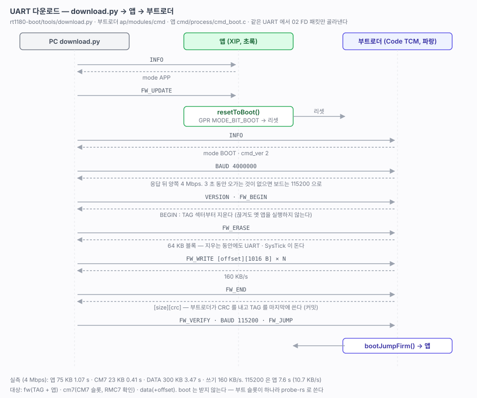

# 43. UART 다운로드 — download.py 로 앱 · CM7 · 데이터 쓰기

> 디버거 없이 CLI 와 같은 UART(MCU-Link VCOM)로 앱 · CM7 이미지 · 데이터를 쓴다. 앱이 돌고 있으면 앱이 부트로더로 넘기고, 부트로더가 QSPI 를 지우고 쓴 뒤 TAG 를 마지막에 기록한다. 명령 · 패킷 · PC 도구는 NUCLEO-N657X0 와 같고, CM7 슬롯 대상을 더했다.
> 관련: [40-boot-architecture.md](40-boot-architecture.md) · [41-bootloader.md](41-bootloader.md) · [42-app-jump.md](42-app-jump.md) · [26-qspi-nor.md](26-qspi-nor.md) · [25-cm7-boot.md](25-cm7-boot.md) (CM7 이미지 형식)
>
> 출처: NUCLEO-N657X0 `stm32n6-boot/src/ap/modules/cmd/` (`cmd_task.c` · `driver/drv_uart.c` · `process/cmd_boot.c`) · `tools/download.py` · `tools/cmdproto.py`.



---

## 1. 결과

```
$ python3 tools/download.py --target fw
baram-term : 포트를 잠시 놓음
연결     : /dev/cu.usbmodemN1APBXYNYYR5I3  FRDM-IMXRT1186-CM33 V261031R2  [APP]
         앱이 실행 중 → 부트로더로 넘어가 다시 붙는다
연결     : /dev/cu.usbmodemN1APBXYNYYR5I3  FRDM-IMXRT1186-BOOT B261031R3  [BOOT]
보낼 것  : rt1180-fw-cm33.bin  75.0 KB -> FW
보율     : 4000000
현재 FW   : FRDM-IMXRT1186-CM33 V261031R2  [TAG] 76756 B  crc 0x692E
  지우기   0.47s
  쓰기     0.47s  (160.3 KB/s)
  확인     0.07s  76756 B  crc 0x692E (호스트 0x692E) OK
  판정   TAG
합계     : 1.07s
실행     : 앱으로 점프
baram-term : 포트 다시 엶
```

| 대상 | 크기 | 지우기 | 쓰기 | 합계 |
|---|---|---|---|---|
| `fw` 4 Mbps | 75 KB | 0.47 s | 0.47 s (160 KB/s) | **1.07 s** |
| `fw` 115200 (`--baud 0`) | 75 KB | 0.46 s | 7.01 s (10.7 KB/s) | 7.62 s |
| `cm7` 4 Mbps | 23.4 KB | 0.26 s | 0.15 s | 0.41 s — 앱으로 점프한 뒤 `CM7 RUNNING` |
| `data +0x10000` 4 Mbps | 300 KB (난수) | 1.53 s | 1.86 s (161 KB/s) | 3.47 s, CRC 일치 |

- 115200 에서 10.7 KB/s 는 선로 한계(11.5 KB/s)의 93 % 다. 4 Mbps 에서는 패킷마다 오가는 응답이 시간 대부분이다.
- 잘못된 파일을 `--target cm7` 로 주면 보드에 붙기 전에 `RMC7 헤더가 없다` 로 끝난다.

## 2. 쓰는 법

```bash
cd firmware/rt1180-boot
python3 tools/download.py                          # fw (../rt1180-fw/build/cm33/rt1180-fw-cm33.bin)
python3 tools/download.py --target cm7             # ../rt1180-fw/build/cm7/rt1180-fw-cm7.img
python3 tools/download.py my.bin --target data --offset 0x10000
```

| 옵션 | |
|---|---|
| `--target fw\|cm7\|data` | 기본 `fw`. `boot` 는 없다 (6절) |
| `--baud B` | 전송 보율. 기본 4000000, `0` 이면 115200 그대로 |
| `--port P` | 없거나 `auto` 면 MCU-Link(VID 0x1FC9, PID 0x0143)를 찾는다. 맥에 다른 보드가 붙어 있어도 고르지 않는다 |
| `--list` | 시리얼 포트 목록. `*` 가 `auto` 가 고르는 포트 |
| `--no-reset` | 끝난 뒤 앱으로 점프하지 않는다 (부트로더에 머문다) |
| `--no-baram` | baram-term 이 포트를 쥐고 있어도 놓게 하지 않는다 |

- `fw` 는 **TAG 를 붙이지 않은 bin** 을 보낸다. TAG 는 부트로더가 쓴다. (probe-rs 기록은 `-tag.bin`, [42](42-app-jump.md) 5절)
- pyserial 이 필요하다.
- VSCode 태스크 `download-cm33` · `download-cm7` 은 포트를 Firmware Task Manager 확장(`baram-dev.firmware-task-manager`)의 시리얼 포트 선택(`firmware-task.pickSerialPort`)으로 고른다. 확장이 태스크마다 마지막 포트를 기억한다. 포트 목록과 `auto` 가 고르는 포트는 태스크 `download-list`.

## 3. 같은 UART 에서 CLI 와 cmd 를 나눈다

USB CDC 처럼 포트를 나눌 수 없어서 **cli 의 RX 필터**가 cmd 패킷만 골라낸다(N657X0 와 같다).

```
UART 수신 ─▶ cliMain() ─▶ rx_filter(b) ─┬─ 02 FD 로 시작 → 패킷 길이만큼 drv_uart 큐 ─▶ cmd 모듈 ─▶ cmdBootProcess()
                                        └─ 나머지 → cli
```

| 바뀐 곳 | 내용 |
|---|---|
| `common/hw/include/cli.h` · `cpu/cm33/hw/driver/cli.c` | `cliSetRxFilter()`. `cliMain()` 이 한 바이트씩이 아니라 **받은 것을 다 꺼낸다**. 앱 cli 스레드는 2 ms 주기라 한 바이트씩이면 패킷이 느려진다 |
| `cpu/cm33/ap/modules/common/cmd/driver/drv_uart.c` (새로) | N657X0 그대로. 필터 · 큐 · 보율 바꾸기 · 3 초 응답 없으면 115200 으로 복귀. 부트로더와 앱이 같이 쓴다 |
| `common/hw/include/boot_cmd.h` (새로) | 명령 코드 · 대상 · `boot_info_t` · `boot_version_t`. 부트로더와 앱이 같은 정의를 쓴다 |
| `common/def.h` | `HW_DEV_MODE_BOOT` · `HW_DEV_MODE_APP` |

## 4. 부트로더 — `ap/modules/cmd`

| 파일 | |
|---|---|
| `cmd_task.c` | `MODULE_DEF(cmd)`. UART 채널 하나, `update` 에서 패킷을 받아 `cmdBootProcess()` |
| `process/cmd_boot.c` | N657X0 `cmd_boot.c` 를 옮겼다. 플래시는 `qspiRead/Write/Erase` 에 오프셋으로 넘긴다 |

| 명령 | 부트로더 |
|---|---|
| `INFO` | `boot_info_t` (mode BOOT, `cmd_ver 2` — 확장 뒤에 `cm7_addr` · `cm7_size`) |
| `VERSION` | 앱의 이미지 판정 · TAG 크기 · CRC · 이름 · 버전 |
| `FW_BEGIN` | `[size][target][offset]`. **fw 는 TAG 섹터를 먼저 지운다** — 전송이 끊겨도 옛 앱을 실행하지 않는다 |
| `FW_ERASE` | fw · cm7 은 64 KB 블록, data 는 4 KB 섹터 |
| `FW_WRITE` | `[offset][data ≤ 1020 B]` (`HW_CMD_MAX_DATA_LENGTH 1024`) |
| `FW_END` | `[size][crc]`. fw 는 CRC 를 내고 **TAG 를 마지막에** 쓴다(커밋). cm7 은 `RMC7` 헤더를 확인한다 |
| `FW_VERIFY` · `FW_JUMP` | 이미지 판정 · 앱으로 점프 |
| `BAUD` | 응답을 다 보낸 뒤(`LPUART_WriteBlocking` 은 TC 까지 기다린다) 보율을 바꾼다. 9600 ~ 6 Mbps (LPUART1 루트 24 MHz) |
| `RESET` | 리셋 |

| 대상 | 영역 | 쓰는 순서 |
|---|---|---|
| `fw` 0 | `0x0404_0000` TAG + 앱 | BEGIN 에서 TAG 지움 → 이미지 → END 에서 TAG |
| `boot` 1 | — | 받지 않는다 (`ERR_BOOT_WRONG_RANGE`) |
| `data` 2 | `0x04C0_0000` + offset (4 KB 단위) | 쓰고 END 에서 CRC |
| `cm7` 3 | `0x0480_0000` CM7 슬롯 | 쓰고 END 에서 `RMC7` 확인. 앱이 부팅 때 헤더의 CRC 를 다시 본다([25](25-cm7-boot.md)) |

## 5. 앱 — UART 채널은 넘기기만 한다

앱의 `cmd` 모듈에 UART 채널을 더했다(CM7 ipc 채널 옆). `process/cmd_boot.c` 는 `INFO`(mode APP) · `VERSION` · `FW_UPDATE` · `RESET` 만 받고 나머지는 `ERR_BOOT_WRONG_CMD` 다. **앱은 플래시를 쓰지 않는다**([26](26-qspi-nor.md) 7절 방침).

`FW_UPDATE` → 응답 → `resetToBoot()` (BBNSM GPR `MODE_BIT_BOOT` + 리셋) → 부트로더가 `boot request` 로 머문다([42](42-app-jump.md) 4절). `download.py` 는 1.5 초 뒤 다시 `INFO` 를 보내 mode BOOT 를 확인한다.

## 6. 부트로더 자신은 UART 로 쓰지 않는다

N657X0 는 FSBL 슬롯이 둘이라(BootROM 이 성한 쪽으로 부팅) FSBL2 에 쓰고 FSBL1 로 복사했다. 이 보드는 부트 슬롯이 하나다. 부트로더가 자기 슬롯을 지우고 쓰다 끊기면 부팅할 것이 없다. 그래서 `boot` 대상은 거절하고 probe-rs(`rt1180-boot` 의 `flash`)로 쓴다. 망가져도 probe-rs 는 부팅과 상관없이 SWD 로 쓴다. 붙지 않으면 J60 를 시리얼 다운로더(`001`)로 두고 다시 쓴다([03](03-board-mapping.md), 확인 필요).

RT1180 ROM 의 이중 이미지 부팅(컨테이너 두 벌)은 48 에서 조사한다.

## 7. TCM 실행의 이점 — 지우는 동안 UART 수신

[40](40-boot-architecture.md) 3절에서 부트로더를 TCM 에서 돌리기로 한 이유를 확인했다. `qspi erase 0xC00000 0x10000` (64 KB 블록, 약 240 ms)를 보내고 **50 ms 뒤 61 바이트 명령**(공백 50 + `reset info`)을 보냈다.

| | 결과 |
|---|---|
| 앱 (XIP, ROM 호출 중 인터럽트를 막는다) | 앞 16 바이트쯤(LPUART RX FIFO)만 남고 `reset info` 가 **없어졌다** |
| 부트로더 (Code TCM) | **61 바이트가 모두 들어와** `reset info` 가 실행됐다 |

`qspi.c` 의 인터럽트 막기는 `hw_def.h` 의 `HW_QSPI_XIP` 로 고른다. 앱은 정의하지 않아 1(막는다), 부트로더는 0 이다. 11 바이트짜리 명령으로 처음 시험했을 때는 앱도 받았다. FIFO 에 다 들어가는 길이였다.

## 8. 걸렸던 것

| 증상 | 원인 | 해결 |
|---|---|---|
| `--target cm7` 에 잘못된 파일을 준 뒤 다음 명령이 응답 없음(받은 49 B) | `download.py` 가 보율을 4 Mbps 로 바꾼 **뒤에** RMC7 헤더를 검사하고 끝났다. 보드는 3 초 동안 4 Mbps 에 남는다 | 헤더 검사를 보드에 붙기 전으로 옮겼다 |
| VSCode 태스크에서 쓰기 84 % 에 `device reports readiness to read but returned no data` | 태스크의 PATH 에 Claude 플러그인 폴더가 없어 `baram-ctl` 을 못 찾았다. baram-term 이 포트를 놓지 않아 두 프로그램이 같은 포트를 읽었다 | `find_baram_ctl()` — PATH 의 `baram-ctl` · `baram-term ctl` → 플러그인의 `ctl.py` → `/Applications/baram-term.app` 순으로 찾는다 |
| 수신 시험에서 앱도 다 받음 | 보드가 앞 시험 때문에 부트로더에 머물러 있었다 / 명령이 FIFO 보다 짧았다 | 앱으로 점프한 뒤, FIFO 보다 긴 명령으로 다시 |

## 9. 확인 필요

- [ ] 6 Mbps (`--baud 6000000`) — MCU-Link VCOM 이 받는지. 4 Mbps 까지 확인
- [x] 전송이 중간에 끊겼을 때 — 위 84 % 에서 끊긴 뒤 보드는 TAG 가 지워진 채(`[VER] 0 B`) 부트로더에 머물렀고, 다시 받아 복구됐다. 케이블을 뽑는 경우는 따로 확인하지 않았다
- [ ] Windows · Linux 에서 포트 찾기 (`list_ports` 의 VID/PID)

## 10. 다음

- [ ] 44 — 앱 · CM7 을 한 번에 (`--target all`?) 또는 묶음 이미지
- [ ] 45 — USB 다운로드 (33 USB 이후)
- [ ] 48 — ROM 이중 이미지 · 보안 부트 조사 (부트로더 자체 업데이트)
