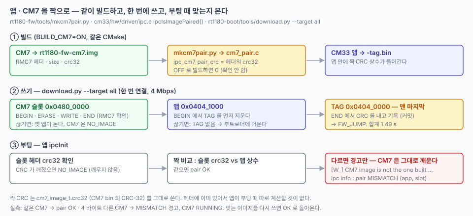

# 44. 앱 · CM7 을 짝으로 — 한 번에 쓰기와 짝 확인

> 앱(CM33)과 CM7 이미지를 UART 로 한 번에 쓰고(`download.py --target all`), 앱이 부팅 때 슬롯의 CM7 이 자기와 같이 빌드한 것인지 확인한다. **짝이 맞지 않아도 경고만 하고 CM7 은 그대로 깨운다.**
> 관련: [25-cm7-boot.md](25-cm7-boot.md) (CM7 이미지 · 기동) · [43-uart-download.md](43-uart-download.md) · [04-dualcore.md](04-dualcore.md)



---

## 1. 결과

```
$ python3 tools/download.py --target all
...
보낼 것  : rt1180-fw-cm7.img  23.4 KB -> CM7
보낼 것  : rt1180-fw-cm33.bin  75.3 KB -> FW
보율     : 4000000
[CM7]
  지우기   0.25s
  쓰기     0.15s  (161.1 KB/s)
  확인     0.01s  23956 B  crc 0x2C64 (호스트 0x2C64) OK
[FW]
  지우기   0.48s
  쓰기     0.47s  (160.8 KB/s)
  확인     0.07s  77060 B  crc 0x83AB (호스트 0x83AB) OK
  판정   TAG
합계     : 1.49s
실행     : 앱으로 점프

cli# ipc info
state      : RUNNING
image      : 0x04800000 magic 0x37434D52 size 23940 crc 0x9E450C41 (calc 0x9E450C41)
pair       : OK (app 0x9E450C41, slot 0x9E450C41)
```

짝이 다른 CM7(같은 코드 뒤에 0 을 4 바이트 붙여 CRC 만 다르게 한 것)을 `--target cm7` 로 쓰면:

```
[OK] CM7 RUNNING (11 ms)
     name  : FRDM-IMXRT1186-CM7
[W_] CM7 image is not the one built with this app (app 0x9E450C41)

cli# ipc info
pair       : MISMATCH (app 0x9E450C41, slot 0x914F1C23)
```

CM7 은 그대로 돈다. 맞는 이미지를 다시 쓰면 `pair : OK` 로 돌아온다.

## 2. 짝 확인

| 무엇 | 어디 |
|---|---|
| 짝의 기준 | CM7 이미지 헤더의 `crc32` (`cm7_image_t`, CM7 bin 의 CRC-32). 앱이 기동 전에 이미 검사하는 값이라 따로 계산할 것이 없다 |
| 앱에 심기 | `tools/mkcm7pair.py` 가 같은 빌드의 `rt1180-fw-cm7.img` 헤더에서 꺼내 `build/cm33/cm7_pair.c` (`ipc_cm7_pair_crc`) 를 만든다. 내용이 같으면 다시 쓰지 않는다 |
| 빌드 순서 | CM33 의 `cm7_pair.c` 가 CM7 `.img` 에 의존한다(CM7 POST_BUILD 의 `BYPRODUCTS`). CM7 을 고치면 앱이 다시 링크되고 TAG 도 새로 만들어진다 |
| `BUILD_CM7=OFF` | `cm7_pair.c` 는 0 을 담는다(`file(CONFIGURE)`). 0 이면 확인하지 않는다 |
| 부팅 때 | `ipcIsImagePaired()` — 슬롯 `crc32` 와 앱 상수 비교. 다르면 `hw.c` 가 `[W_]` 한 줄을 남긴다 |
| CLI | `ipc info` 의 `pair : OK / MISMATCH (app, slot) / -` |

**막지 않는 이유.** 지금은 앱과 CM7 을 따로 고치고 따로 쓰는 일이 잦다(`flash-cm7`, `download-cm7`). 구조가 바뀌면 `SHARED_VERSION` 이 다르게 되어 `BAD_VERSION` 으로 이미 막힌다. 짝 확인은 "구조는 같은데 다른 빌드" 를 알려 주는 용도다. 나중에 배포할 때 막을지는 그때 정한다.

## 3. 한 번에 쓰기 — `--target all`

| 순서 | 끊기면 |
|---|---|
| 1. CM7 슬롯 (BEGIN · ERASE · WRITE · END, `RMC7` 확인) | TAG 는 그대로라 **옛 앱이 돈다.** CM7 은 CRC 가 깨져 `NO_IMAGE` |
| 2. 앱 (BEGIN 에서 TAG 를 먼저 지운다) | TAG 가 없어 **부트로더에 머문다** |
| 3. TAG (END) — 맨 마지막 | — |

어느 쪽에서 끊겨도 다시 보내면 된다. 연결 · 보율 변경은 한 번만 한다.

| 쓰는 법 | |
|---|---|
| 명령줄 | `python3 tools/download.py --target all` (기본 bin 둘. bin 을 주면 거절) |
| VSCode | 태스크 `download-all` (`download-cm33` · `download-cm7` 옆) |
| 디버거 | 태스크 `flash-all` (전과 같다) |

## 4. 하지 않기로 한 것

| 안 | 판단 |
|---|---|
| ROM 컨테이너에 CM33 · CM7 이미지 두 개 | 하지 않는다. ROM 컨테이너는 부트로더 것이다([41](41-bootloader.md)). 앱 쪽 CM7 을 ROM 이 실을 수 없고, 부트로더를 업데이트하지 않는 구조와도 맞지 않는다 |
| 부트로더가 CM7 을 깨우기 | 하지 않는다. 지금처럼 **앱이** 깨운다([25](25-cm7-boot.md)). 부트로더가 하면 클럭 · DCDC · ELE 까지 알아야 해서 커지고, 점프할 때 CM7 상태를 넘겨야 한다 |
| 앱 · CM7 을 한 파일로 묶기 | 지금은 하지 않는다. `--target all` 이 기본 경로의 두 파일을 같은 빌드에서 가져오므로 충분하다. 배포 파일이 필요해지면(45~47) 그때 |

## 5. 확인 필요

- [ ] `--target all` 이 CM7 을 쓰다 끊겼을 때 옛 앱 + `NO_IMAGE` 로 도는지 (순서로 본 판단. 끊어 보지는 않았다)

## 6. 다음

- [ ] 50~ 네트워크 (CM7)
- [ ] 45~47 USB · 웹 · 네트워크 업데이트 — 배포용 묶음 파일이 필요해지면 그때
