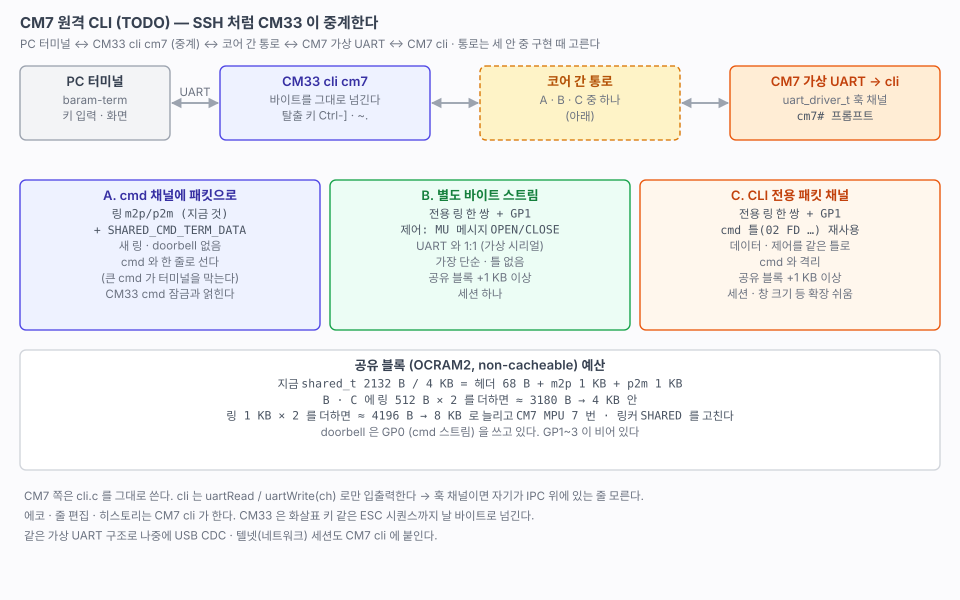

# 90. TODO — CM33 을 통해 CM7 CLI 쓰기 (원격 터미널)

> **아직 구현하지 않았다.** 설계 메모다. CM7 에 CLI 를 올리고, PC 에서 CM33 콘솔로 들어가 SSH 처럼 CM7 셸에 붙는 방법을 정리한다. 전송 방식(패킷 · 별도 스트림 · CLI 전용 패킷 채널)은 구현할 때 아래 기준으로 고른다.
> 관련: [25-cm7-boot.md](25-cm7-boot.md) 10 · 11절 (MU, 공유 링, cmd 패킷) · [28-freertos.md](28-freertos.md) 5절 (CM7 module · 로그) · [21-uart-cli.md](21-uart-cli.md)
>
> 선례: stm32h5-w6300 `ap/modules/common/cli/driver/cli_net.c`(텔넷 소켓을 가상 UART 로), `ap/modules/cmd/driver/drv_cli.c`(**cmd 패킷 위에 얹는 가상 CLI 채널**, 출력 버퍼 4 KB, `cli_mgr` 포트 자동 전환).

---

## 1. 무엇을 만드나

| SSH | 이 보드 |
|---|---|
| 네트워크 연결 | 코어 간 통로 (공유 링 + MU doorbell). 2절의 세 안 중 하나 |
| 원격의 가상 터미널(pty) | CM7 의 **가상 UART 채널** — `uart_driver_t` 훅에 IPC 를 붙인다 |
| 원격 셸 | CM7 의 `cli.c` (CM33 과 같은 파일) |
| 로컬 ssh 클라이언트 | CM33 CLI 명령 **`cli cm7`** — 키 입력을 CM7 로 넘기고 CM7 출력을 콘솔에 찍는 **중계 모드** |

목표는 **대화형 세션**이다(`ssh host`). 명령 한 번 실행(`ssh host cmd`)은 같은 부품으로 더 쉽게 되므로 먼저 만들어 디딤돌로 써도 된다(6절).

### 명령 이름

| 명령 | 뜻 | SSH 로 치면 |
|---|---|---|
| `cli cm7` | CM7 셸에 들어간다. 탈출 키로 나온다 | `ssh host` |
| `cli cm7 <명령…>` | CM7 에서 명령 하나를 실행하고 출력을 받아 온다. 예: `cli cm7 thread cpu` | `ssh host cmd` |
| `cli` · `cli info` | (나중) CLI 채널 목록 — UART · CM7 · 텔넷이 붙으면 어느 채널이 무엇인지 | — |

`cli` 라는 명령은 아직 없다(지금 CM33 명령: button help hwinfo ipc log md module peer psram pwm qspi reset rtc thread uart). `peer` 는 지금처럼 코어 간 **시험** 명령(info · echo · read · cpu · log)으로 두고, CLI 를 넘나드는 것은 `cli` 아래에 모은다. 나중에 대상이 늘면(`cli net` 같은 텔넷 상대) 같은 모양으로 붙인다.

### 핵심: CM7 cli 는 자기가 IPC 위에 있는 줄 모르게 한다

- `cli.c` 는 `uartRead()` / `uartWrite()` / `uartAvailable()` 로만 입출력한다.
- `uart.c` 에는 이미 `uartSetDriver(ch, &driver)` 훅이 있다. stm32h5-w6300 이 이 훅으로 텔넷 소켓(`cli_net.c`)과 cmd 패킷(`drv_cli.c`)을 UART 채널처럼 붙였다. `cli.c` 는 손대지 않았다.
- CM7 에 **LPUART 없이 훅 채널만 있는 작은 `uart.c`** 를 두고, 그 채널의 read / write 를 통로에 잇는다.
- 그러면 CM7 cli 는 실제 UART 에서 돌 때와 똑같다. 나중에 이더넷 텔넷 세션(50 번대)도 같은 훅으로 CM7 cli 에 붙인다.
- 에코 · 줄 편집 · 히스토리는 CM7 cli 가 한다. CM33 은 화살표 키 같은 ESC 시퀀스까지 **날 바이트로** 넘긴다. CM7 의 `cliKeepLoop()`(계속 도는 명령을 키로 멈추기)도 그대로 된다.

## 2. 통로 — 세 안

| | A. cmd 채널에 패킷으로 | B. 별도 바이트 스트림 | C. CLI 전용 패킷 채널 |
|---|---|---|---|
| 구성 | 지금 링(m2p/p2m) + 새 id `SHARED_CMD_TERM_DATA` | 전용 링 한 쌍 + doorbell **GP1**. 제어는 MU 메시지(`ipcMsgSend`) `TERM_OPEN` / `TERM_CLOSE` | 전용 링 한 쌍 + GP1. cmd 틀(`02 FD` type cmd err len data sum)을 그대로 쓰고 채널만 따로 |
| 새로 드는 것 | id 하나 | 링 · doorbell · 제어 메시지 | 링 · doorbell · 두 번째 `cmd_t` |
| 바이트당 부담 | 패킷 헤더 10 B / 묶음 | 없음 | 패킷 헤더 10 B / 묶음 |
| cmd 와의 관계 | **한 줄로 선다.** 큰 cmd(앞으로 펌웨어 · 대용량)가 터미널을 막고, 터미널 출력이 cmd 응답 사이에 낀다 | 격리 | 격리 |
| CM33 쪽 얽힘 | cmd 채널 잠금(`cmdTaskLock`)과 엮인다. `peer echo` 같은 긴 명령 동안 터미널이 멈춘다 | 없음 | 없음 |
| 제어 신호 (열기 · 닫기 · break · 창 크기) | 같은 패킷 틀로 | 데이터 밖(MU 메시지)으로 — UART 의 모뎀 신호선 같은 것 | 같은 패킷 틀로 (type 이나 cmd 로 구분) |
| 세션 여러 개 | id 로 구분 가능 | 링 쌍마다 하나 | 패킷에 세션 번호를 넣으면 한 채널에 여럿 |
| 가상 UART 와의 맞춤 | 패킷을 풀어 바이트로 넘기는 층이 필요 | **1:1.** 링 = 시리얼 케이블 | 패킷을 풀어 바이트로 넘기는 층이 필요 |
| 공유 메모리 | 그대로 | +링 두 개 | +링 두 개 |

### stm32h5-w6300 은 어떻게 했나

`drv_cli.c` 는 **cmd 패킷 위에 가상 CLI 채널**을 얹었다(A · C 계열). 주석: *"전송이 HID 든 CDC 든 (향후) W6300 이든 상관없다. cmd.c 가 전송계층과 무관하고 이 채널은 그 위에 있기 때문이다."* 출력은 4 KB 버퍼에 모으고, 넘치면 꼬리에 잘림 표시를 넣는다. `cli_mgr` 가 어느 채널(UART · 텔넷 · cmd)이 CLI 를 쥘지 자동으로 바꾼다.

그 구조를 따르면 **패킷 방식이 이미 검증된 길**이다. 다만 거기서는 cmd 채널이 PC 와의 링크 하나였고, 여기서는 코어 간 cmd 채널에 이미 다른 트래픽(echo · 앞으로 대용량)이 있다. 그래서 같은 패킷 틀을 쓰되 **채널을 따로 두는 C** 가 그 경험과 이 보드 사정을 함께 맞춘다.

### 지금의 판단 (확정 아님)

- **A 는 피한다.** 터미널이 cmd 와 같은 줄에 서서, 둘 중 하나가 커지면 서로 막는다. CM33 쪽 잠금과도 얽힌다.
- **B 와 C 중 하나.** 둘 다 cmd 와 격리된다.
  - **B** 가 가장 단순하고 가상 UART 와 1:1 이다. 제어는 이미 있는 MU 메시지로 하면 된다.
  - **C** 는 틀이 있어 세션 번호 · 창 크기 · break 같은 확장이 쉽다. cmd 모듈 코드를 그대로 다시 쓴다.
- 결정 기준
  - 세션이 하나뿐이고 제어가 열기 · 닫기 정도면 → **B**
  - CM7 로그 실시간 스트림, 여러 세션, 텔넷 · USB 를 같은 틀로 묶고 싶으면 → **C**
  - stm32h5-w6300 `drv_cli.c` 를 거의 그대로 가져올 수 있다는 점에서 **C 쪽으로 기운다**

### 공유 블록 예산

| 경우 | 크기 | 할 일 |
|---|---|---|
| 지금 | `shared_t` 2132 B / 4 KB (헤더 68 B + 링 1 KB × 2) | — |
| B · C, 링 512 B × 2 를 더함 | 약 3180 B | 4 KB 안. 터미널에는 512 B 로 충분하다 (사람이 치는 속도) |
| 링 1 KB × 2 를 더함 | 약 4196 B | 블록을 **8 KB** 로 늘린다. `SHARED_BLOCK_SIZE`, 두 링커의 `SHARED`, CM7 MPU 7 번(크기 · 정렬), CM33 MPU 는 OCRAM2 전체가 이미 non-cacheable |

- doorbell 은 GP0 을 cmd 스트림이 쓴다. **GP1~3 이 비어 있다.**
- 구조체가 바뀌면 `SHARED_VERSION` 을 올린다.

## 3. CM7 쪽

| 할 일 | 내용 |
|---|---|
| `hw/driver/uart.c` (작은 것) | LPUART 없음. 채널 하나(`_DEF_UART1`)를 훅 전용으로 둔다. `uartSetDriver()` · `uartOpen/Read/Write/Available` |
| 통로 드라이버 | 훅의 read · write · available 을 2절 통로에 잇는다. 쓰기는 **묶어 보낸다**(128 B 가 차거나, 줄바꿈이거나, 2 ms 조용하면) — `cliPrintf()` 가 글자마다 통로를 타지 않게. C 를 고르면 stm32h5-w6300 `drv_cli.c` 를 바탕으로 한다 |
| `hw/driver/cli.c` | CM33 것 그대로 (`_USE_HW_CLI`). 프롬프트는 `cm7# ` 으로 해 어느 코어인지 보이게 |
| 채널 고르기 | 나중에 CM7 에 텔넷(50 번대)까지 붙으면 stm32h5-w6300 의 `cli_mgr` 처럼 어느 채널이 CLI 를 쥘지 고르는 층이 필요하다 |
| `ap/modules/common/cli` | CM33 과 같은 cli 모듈 · 스레드. 받을 것이 없으면 세마포어에서 잔다 (doorbell 이 깨운다 — 지금 cmd 스레드와 같다) |
| 로그 | CM7 `logPrintf()` 를 cli 채널로도 내보낼지 정한다. 지금은 버퍼에만 쌓고 `peer log` 로 본다 |
| 메모리 | 수 KB (cli 버퍼 · 히스토리 · 스레드 스택) |

## 4. CM33 쪽 — `cli cm7`

1. `cli cm7` 을 치면 CM7 에 세션을 연다(B: MU `TERM_OPEN` / C: 열기 패킷).
2. CLI 스레드가 **중계 모드**에 들어간다. 이 동안 CM33 cli 파서는 쉰다.
   - UART 에서 들어온 바이트 → 통로로
   - 통로에서 온 바이트 → UART 로
3. **탈출 키**를 보면 세션을 닫고 CM33 프롬프트로 돌아온다. 후보는 다음 둘이다.
   - 텔넷식 `Ctrl-]`
   - SSH 식 줄 첫머리 `~.`
4. CM7 이 응답하지 않으면(alive 가 멈춤, `ipcIsRunning()` 거짓) 경고를 찍고 빠져나온다.

정할 것:
- CM33 cmd 모듈이 지금 버리는 "CM7 이 먼저 보낸 패킷"의 처리 (C 를 고르면 별도 채널이라 상관없다)
- 중계 중에도 CM33 로그(`logPrintf`)를 화면에 섞을지

## 5. 확인할 것 (구현할 때)

- [ ] 키 입력 → 에코 지연 (목표: 사람이 못 느끼는 수 ms)
- [ ] 1 KB 붙여넣기에서 글자를 잃지 않는지 (링 · 흐름 제어)
- [ ] 화살표 히스토리, `Ctrl-C`, `cliKeepLoop()` 명령 중단
- [ ] CM7 을 디버거로 멈췄을 때 `cli cm7` 이 시간 초과로 빠져나오는지
- [ ] 세션을 닫았다 다시 열 때 남은 바이트가 섞이지 않는지 (열 때 링 비우기)
- [ ] CM33 쪽 다른 일(cmd 모듈, LED)이 중계 중에도 도는지

## 6. 단계

1. (선택) **명령 한 번 실행** `cli cm7 <명령…>` — 기존 cmd 패킷으로 문자열을 보내고, CM7 이 `cliRunStr()` 로 실행하는 동안 출력을 모아 응답으로 돌려준다. CM7 cli 를 먼저 올려 보는 디딤돌이다.
2. 통로를 B 또는 C 로 정하고 공유 블록을 늘린다.
3. CM7 훅 `uart.c` + cli 모듈.
4. CM33 `cli cm7` 중계 모드와 탈출 키.
5. 5절 확인 → 문서를 `2x` 대역의 정식 문서로 옮긴다.
